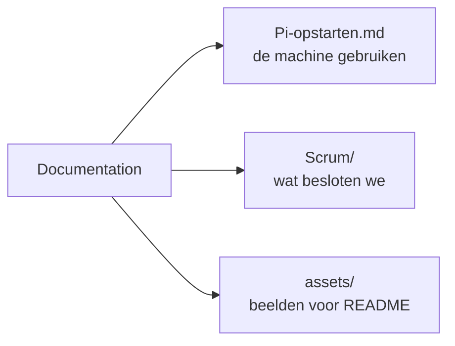

# Documentation

## Wat is dit?
Documentatie over het **project en de werkwijze** van het team, niet over één onderdeel: scrumverslagen, de opstartgids voor de Raspberry Pi en afbeeldingen voor de README.

## Waarom staat het hier?
Onderdeel-specifieke uitleg staat bij het onderdeel zelf (bv. in [Hardware](../Hardware/README.md)). Hier staat wat voor het hele project geldt.

## Inhoud
| Bestand of map | Wat is het? | Wanneer open je dit? |
|---|---|---|
| [Pi-opstarten.md](Pi-opstarten.md) | Stap-voor-stap gids: Raspberry Pi 5 instellen, opstarten, problemen oplossen | Je wilt de machine laten draaien |
| [Scrum/](Scrum/README.md) | Verslagen van elke scrummeeting en het sjabloon | Je wilt weten wat wanneer besloten werd |
| [assets/](assets/README.md) | Afbeeldingen voor de hoofd-README (poster, screenshots) | Je werkt aan de README |

