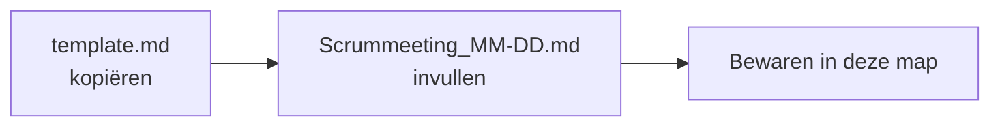

# Scrum

## Wat is dit?
De verslagen van onze scrummeetings: aanwezigen, doelen, acties en wat er besloten werd.

## Waarom bewaren we dit?
Zo kun je later nagaan waarom een keuze gemaakt werd of wat er die week blokkeerde.

## Inhoud
| Bestand | Wat is het? |
|---|---|
| [template.md](template.md) | Leeg sjabloon |
| [Scrummeeting_10-29.md](Scrummeeting_10-29.md) | Verslag van 29 oktober 2026 |
| [Scrummeeting_11-12.md](Scrummeeting_11-12.md) | Verslag van 12 november 2026 |

## Een nieuw verslag maken

Gebruik dezelfde naamgeving als de bestaande verslagen: `Scrummeeting_MM-DD.md`.
