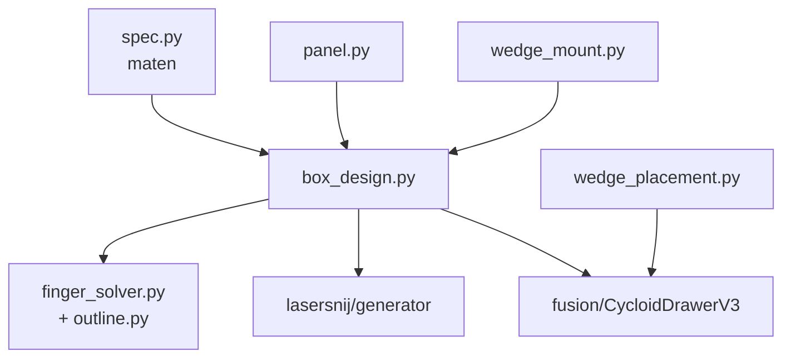

# box_design

## Wat is dit?
De code die de houten kast berekent: welke panelen er zijn, hoe groot ze zijn en hoe hun vingerverbindingen in elkaar grijpen. Er zit geen tekencode of CAD in, alleen berekeningen.

## Waarom staat het hier?
Zowel de lasersnijgenerator ([lasersnij](../lasersnij/README.md)) als het Fusion-script ([fusion](../fusion/README.md)) hebben dezelfde kast nodig. Eerder stond deze code **twee keer** (gekopieerd). Nu staat ze één keer, op het niveau van beide gebruikers, zodat een aanpassing nooit op één plek vergeten wordt.

## Inhoud
| Bestand | Verantwoordelijkheid |
|---|---|
| `spec.py` | De maten van de kast (alleen gegevens) |
| `box_design.py` | Bouwt alle panelen van de kast met twee compartimenten |
| `panel.py` | Eén plat paneel met gaten en uitsparingen |
| `finger_solver.py` | Zet overlappende panelen om in vingerverbindingen |
| `outline.py` | Zoekt de omtrek van een gevulde vorm |
| `wedge_mount.py` | De sleuven in de voorwand voor het [bedieningspaneel](../../Bedieningspaneel/README.md) |
| `wedge_placement.py` | Waar de wig op de kast staat. Alleen het Fusion-script gebruikt dit. |

## Hoe vinden de gebruikers deze map?
Ze staat naast `fusion/` en `lasersnij/`. Het Fusion-script en `generator/main.py` voegen `Hardware/BoxV3` toe aan het Python-pad en importeren `box_design`.
