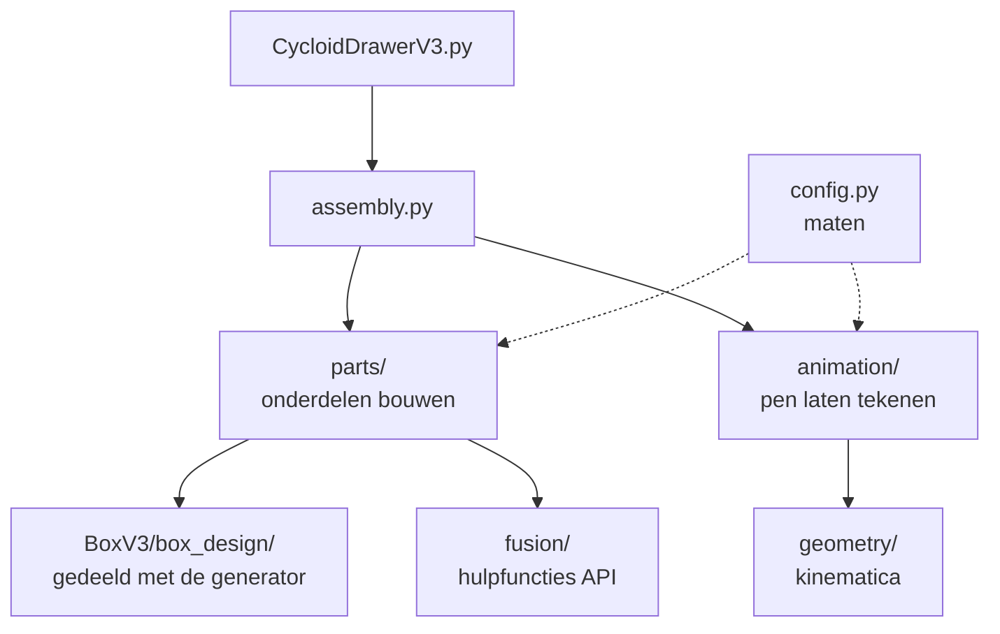

# Fusion 360-script

## Wat is dit?
Een script voor **Autodesk Fusion 360** dat de volledige machine als 3D-model opbouwt en optioneel animeert. Je gebruikt het om de kast te bekijken, te controleren of alles past en een video te maken.

## Waarom hier?
Het hoort bij de kast ([BoxV3](../README.md)) en gebruikt dezelfde maten als de lasergenerator.

## Gebruik
Fusion 360 → Utilities → Add-Ins → Scripts and Add-Ins → **+** → *Script from my computer* → kies de map [CycloidDrawerV3](CycloidDrawerV3) → *Run*.

Let op: verplaats de map `CycloidDrawerV3` niet los van de rest van `BoxV3`. Het script gebruikt de gedeelde map `BoxV3/box_design` en de wig uit `Hardware/Bedieningspaneel`.

## Inhoud van `CycloidDrawerV3/`
| Onderdeel | Wat doet het? |
|---|---|
| `CycloidDrawerV3.py` | Het startpunt dat Fusion uitvoert |
| `CycloidDrawerV3.manifest` | Laat Fusion het script herkennen |
| `cycloid/config.py` | **Alle maten**. Hier pas je aan. |
| `cycloid/assembly.py` | Zet alles in elkaar in de thuisstand |
| `../../box_design/` | Berekent de kastpanelen en vingerverbindingen. Gedeeld met de generator, zie [box_design](../box_design/README.md) |
| `cycloid/parts/` | Bouwt de losse onderdelen: kast, armen, motoren, wig |
| `cycloid/geometry/` | Wiskunde van de twee armen (geen Fusion nodig) |
| `cycloid/animation/` | Berekent en speelt de animatie van de pen |
| `cycloid/fusion/` | Dunne hulpfuncties rond de Fusion-API |
| `tests/` | Tests voor de animatie. Draaien buiten Fusion. |

## Hoe het samenhangt

Code die niet van Fusion afhangt (zoals `geometry/` en `animation/motion_plan.py`) is testbaar zonder Fusion: `python -m unittest discover -s tests -t .`.
