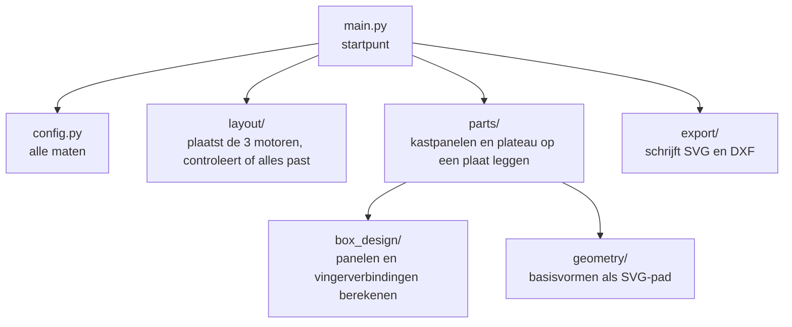

# Lasersnijbestanden en generator

## Wat is dit?
De bestanden die naar de lasersnijder gaan, en de Python-**generator** die ze maakt.

## Waarom een generator?
De maten van de kast veranderden meermaals. Met een generator pas je één getal aan in [config.py](generator/config.py) en maak je alle bestanden opnieuw. De vingerverbindingen worden zo automatisch berekend en passen altijd.

## Inhoud
| Bestand of map | Wat is het? |
|---|---|
| `1_doos_met_motorgaten.svg/.dxf` | Alle panelen van de kast met vingerverbindingen, sleuven voor het paneel en motorgaten |
| `2_plateau.svg/.dxf` | Het ronde plateau (Ø210 mm) dat het papier draagt |
| `montage_bovenaanzicht.svg` | Alleen ter controle: deksel met motoren en krukcirkels. **Niet snijden.** |
| [generator/](generator/) | De code die bovenstaande bestanden maakt |

Genereren: `cd generator` en dan `python main.py ..` (zie [BoxV3](../README.md#lasersnijbestanden-genereren)).

## Opbouw van de generator

| Map | Verantwoordelijkheid |
|---|---|
| `box_design/` | Berekent de panelen van de kast en hun vingerverbindingen. Bevat geen tekencode. |
| `layout/` | Plaatst de motoren op het deksel. Stopt met een melding als iets niet past. |
| `parts/` | Zet de panelen en het plateau plat op een snijplaat |
| `geometry/` | Basisvormen (lijnen, cirkels) als SVG-pad |
| `export/` | Schrijft het resultaat naar SVG en DXF. In de DXF staat enkel snijwerk. |
| `test_sync.py` | Test dat de generator en het Fusion-script dezelfde kast beschrijven |

## Let op
- `box_design/` bestaat ook in het Fusion-script ([fusion](../fusion/README.md)). De code is nu **gekopieerd**, omdat Fusion een zelfstandige map nodig heeft. Pas je een van beide aan, doe het dan in allebei; `test_sync.py` helpt controleren.
- Er is geen kerfcompensatie van de lasersnijder ingebouwd.
