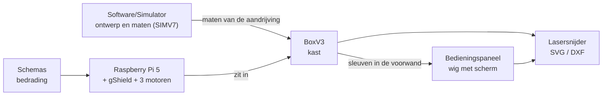

# Hardware

## Wat is dit?
Alles om de machine **fysiek** te bouwen: de houten kast, het bedieningspaneel en de elektronicaschema's.

## Waarom staat het hier?
Alles wat je snijdt, plooit of aansluit staat bij elkaar. De code die de motoren aanstuurt staat in [Software](../Software/README.md). Het onderzoek waarom we bepaalde onderdelen kozen staat in [Research](../Research/README.md).

## Inhoud
| Map | Wat zit erin? | Wanneer open je dit? |
|---|---|---|
| [BoxV3](BoxV3/README.md) | De huidige kast van 4 mm MDF: Fusion 360-script en generator voor de lasersnijbestanden | Je wilt de kast aanpassen of opnieuw laten snijden |
| [Bedieningspaneel](Bedieningspaneel/README.md) | De wig met het 7"-scherm, als Python-generator voor lasersnijbestanden | Je wilt het paneel aanpassen of opnieuw laten snijden |
| [Schemas](Schemas/README.md) | Aansluitschema Raspberry Pi 5 ↔ gShield en de architectuurtekening | Je wilt weten wat waarmee verbonden is |

## Hoe hangen de onderdelen samen?

## Belangrijk om te weten
- De mechanica (armen, krukken, lagers) komt uit de [simulator](../Software/Simulator/README.md). Die onderdelen zijn 3D-geprint en worden hier niet opnieuw getekend.
- De kast en het paneel moeten op elkaar passen. Daarom staan de maten van de sleuven op twee plaatsen, en controleert een test of ze gelijk zijn (zie de README's in de submappen).
- Oudere kastversies (V1, V2) staan op de [archiefbranch](https://github.com/vives-project-xp/Motio/tree/archive).
