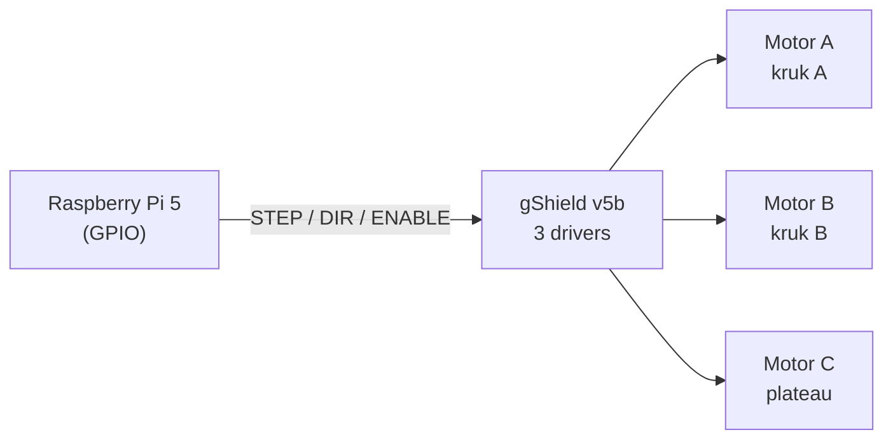

# Schemas

## Wat is dit?
De tekeningen die uitleggen hoe de elektronica is aangesloten en hoe het systeem in elkaar zit.

## Waarom staat het hier?
Het is documentatie bij de hardware: je hebt het nodig als je kabels aansluit, niet als je code schrijft. Daarom staat het in `Hardware` en niet in `Documentation`.

## Inhoud
| Bestand | Wat zie je? |
|---|---|
| [Hardware-schema.md](Hardware-schema.md) | Korte uitleg: Pi 5 stuurt via de gShield drie stappenmotoren aan |
| [Pi-gShield-pinlayout.png](Pi-gShield-pinlayout.png) | Welke Pi-pin met welke gShield-pin verbonden is |
| [gShield.png](gShield.png) | De gShield v5b-kaart met aansluitingen |
| [Architectuur/](Architectuur/README.md) | Overzichtstekening van het hele systeem (bewerkbaar met draw.io) |

## Signaalweg in het kort

De pinnummers per as staan in de [opstartgids](../../Documentation/Pi-opstarten.md#4-bedrading). Meer over de kaart zelf: [Research/gShield-v5b](../../Research/gShield-v5b/BasisWerking.md).
