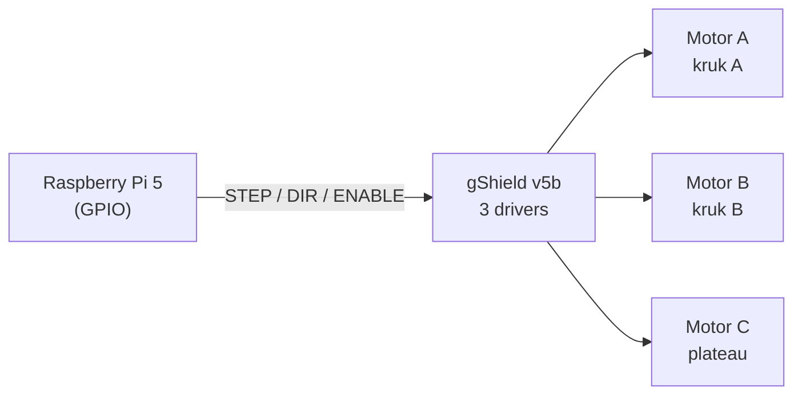
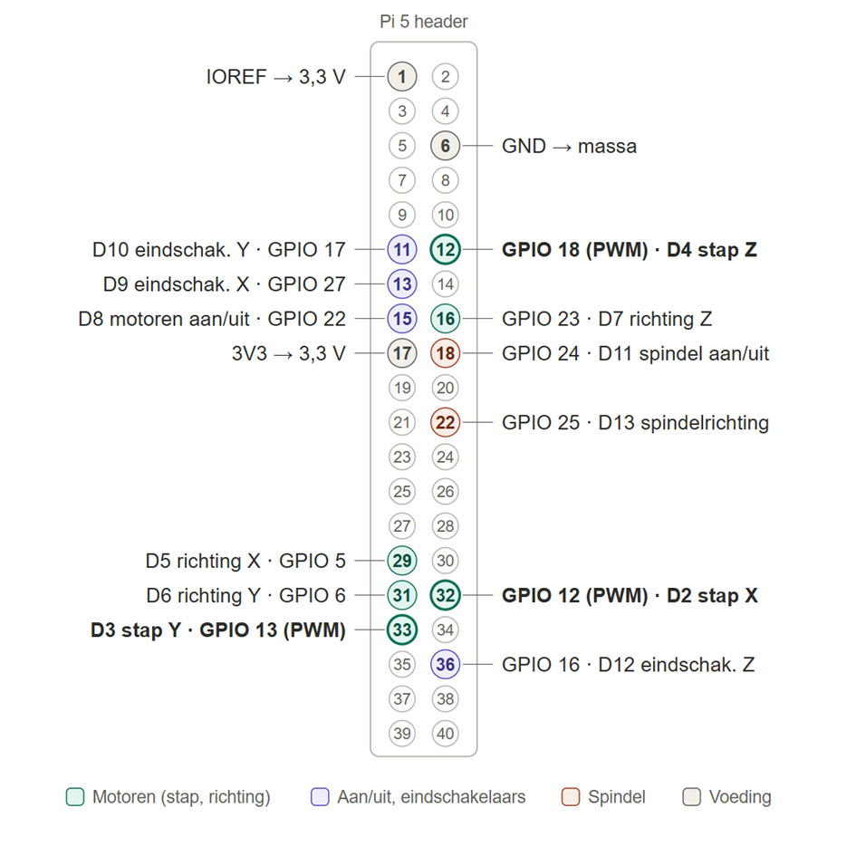
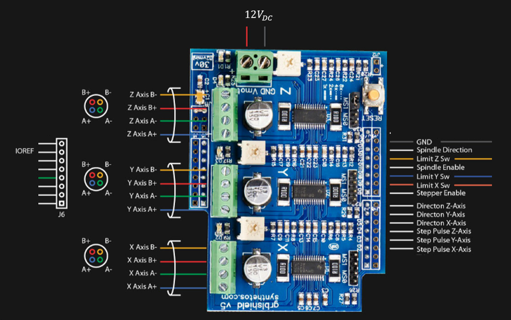

# Schemas

## Wat is dit?
De tekeningen die uitleggen hoe de elektronica is aangesloten en hoe het systeem in elkaar zit.

## Waarom staat het hier?
Het is documentatie bij de hardware: je hebt het nodig als je kabels aansluit, niet als je code schrijft. Daarom staat het in `Hardware` en niet in `Documentation`.

## Hoe is het aangesloten?
Drie stappenmotoren worden aangestuurd door een Raspberry Pi 5, via een Synthetos gShield v5b als driverkaart. De gShield is ontworpen als shield voor een Arduino; wij sluiten hem aan op de GPIO-header van de Pi.

Een Python-programma op de Pi maakt de stap- en richtingssignalen, met een grafische interface. Het testprogramma staat in [Software/TestCode](../../Software/TestCode/RaspberryPi5/README.md), de eigenlijke applicatie in [Software/Pi-Interface](../../Software/Pi-Interface/README.md).

De verbinding tussen de Pi en de gShield volgt de pinindeling hieronder. De pinnummers per as staan ook in de [opstartgids](../../Documentation/Pi-opstarten.md#4-bedrading).

## Inhoud
| Bestand of map | Wat zie je? |
|---|---|
| `assets/Pi-gShield-pinlayout.png` | Welke Pi-pin met welke gShield-pin verbonden is |
| `assets/gShield.png` | De gShield v5b-kaart met aansluitingen |
| [Architectuur/](Architectuur/README.md) | Overzichtstekening van het hele systeem (bewerkbaar met draw.io) |

Meer over de kaart zelf: [Research/gShield-v5b](../../Research/gShield-v5b/gShield-v5b.md).
