# Motio

*Makes motion visible.*

[](https://www.vives.be/nl/technology/elektronica-ict)
[](https://github.com/vives-project-xp)
[](https://github.com/vives-project-xp/Motio/tree/main)

> Een innovatief project voor het zichtbaar en tastbaar maken van beweging,
> door meerdere bewegende elementen om te zetten in fysieke tekeningen op papier.


## Inhoudsopgave

- [Motio](#motio)
  - [Inhoudsopgave](#inhoudsopgave)
  - [Archief](#archief)
  - [Projectoverzicht](#projectoverzicht)
  - [Projectstatus](#projectstatus)
  - [Functies](#functies)
  - [Hoe het werkt](#hoe-het-werkt)
  - [Technologie](#technologie)
    - [Hardware](#hardware)
    - [Software](#software)
  - [Onderdelenlijst (BOM)](#onderdelenlijst-bom)
  - [Project Structuur](#project-structuur)
  - [Scrummeetings](#scrummeetings)
  - [Simulators](#simulators)
    - [Screenshots](#screenshots)
    - [Beginposter](#beginposter)
  - [Team](#team)
  - [Academische Context](#academische-context)

## Archief

De [branch `archive`](https://github.com/vives-project-xp/Motio/tree/archive) bewaart de oude simulatoren (SIMV1 t.e.m. SIMV6, inclusief SIMV4-5), Box V1/V2, oude uitvoer en tijdelijke bestanden. Op `main` staan de bestanden waarmee we verder werken.

Deze archiefbranch blijft beschikbaar en kan later worden aangevuld: bewaar verouderde bestanden daar voordat je ze uit `main` verwijdert.

## Projectoverzicht

Het Motio project is een initiatief ontwikkeld door 2de- en 3dejaars bachelorstudenten Elektronica-ICT van VIVES voor het vak Project Experience. Ons doel is het creëren van een systeem dat bewegingen tastbaar en zichtbaar maakt door ze om te zetten in fysieke tekeningen.

Het systeem combineert de beweging van meerdere elementen om complexe patronen te genereren. Een tekeninstrument vertaalt deze gecombineerde beweging naar lijnen op papier. Door parameters zoals snelheid, richting, fase en bewegingsverhouding te variëren, ontstaan telkens andere visuele patronen. Op die manier wordt de onderliggende beweging niet alleen geregistreerd, maar ook fysiek vastgelegd.

## Projectstatus

*Stand in oktober 2026.*

| Onderdeel | Status | Toelichting |
| --------- | ------ | ----------- |
| Concept & onderzoek | Afgerond | Cycloïde-tekenmachine, keuze motoren (SY42STH38-1684A), scherm en lagers. Zie [Research](Research/README.md). |
| Box V1 | Afgerond | Manueel aangedreven prototype dat één patroon tekent. Zie [UitlegBoxV1](Research/concept/UitlegBoxV1.md). |
| Box V2 | Afgerond (ontwerp) | Parametrisch Fusion-model (CycloidDrawerV2) en lasersnijbestanden met tandwielaandrijving. Vervangen door V3. |
| Box V3 | Gebouwd | Kast van 4 mm MDF met de motoraandrijving van SIMV7, gemaakt met een generator voor lasersnijbestanden en een Fusion-script. Zie [Box V3](Research/concept/v3/README.md). |
| Simulator | Afgewerkt | SIMV7 met 13 patronen, woordgenerator, veiligheidscontroles en montagehandleiding. Oudere versies staan op de archiefbranch. |
| Bedieningspaneel | In uitwerking | Wig van 4 mm MDF met 7" Raspberry Pi-scherm; maten en snijbestanden worden gegenereerd. Zie [Bedieningspaneel](Hardware/Bedieningspaneel/README.md). |
| Elektronica | Gestart | Schema's voor Raspberry Pi 5 en gShield, testcode voor motoraansturing (PWM). |
| Pi-interface | Eerste versie | `Software/Pi-Interface/motio.py` laat de simulator de echte motoren aansturen. Gebaseerd op SIMV5, dus nog geen SIMV7-driver, en nog niet getest op de volledige machine. |
| Volledige machine | Nog niet gebouwd | Mechanica en elektronica zijn nog niet samen werkend gemonteerd. |

### Volgende stappen

1. **Elektronica koppelen aan de mechanica:** de drie motoren werkend op de box, eerst met testcode, daarna via de Pi-interface.
2. **Eerste echte tekening maken** met de gebouwde Box V3.
3. **Pi-interface bijwerken** naar SIMV7 (1/8 microstepping, juiste Home-referentie).

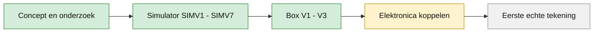

## Functies

- **Instelbare parameters:** snelheden, richtingen en fase zijn makkelijk regelbaar.
- **Visualisatie:** de beweging wordt gevisualiseerd door een tekeninstrument dat lijnen op papier maakt.
- **Preview:** de simulator toont het verwachte resultaat licht op het papier, de echte tekenlijn verschijnt donker.
- **Patronen en woorden:** dertien kant-en-klare patronen en een woordgenerator (tot 8 letters) voor verbonden bubbelletters.
- **Veiligheidscontroles:** de simulator blokkeert singulariteiten, botsingen en posities buiten de veilige tekenzone.
- **Modulaire opbouw:** gescheiden hardware- en softwarecomponenten voor eenvoudige uitbreiding.

## Hoe het werkt

De simulator in de browser berekent de motorstanden en bewaakt de veiligheid. De Raspberry Pi 5 ontvangt die standen en zet ze om in step-pulsen voor de drie drivers op de gShield. Motor A en B bewegen de twee armen, motor C draait het plateau met het papier. De pen blijft op de samengestelde beweging van de armen en het plateau.

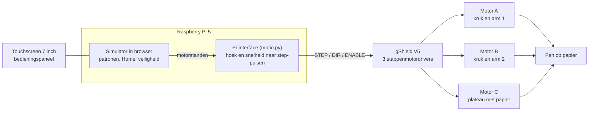

De pinindeling staat in het [hardwareschema](Schemas/Hardware%20schema.md) en in de [architectuurtekening](documentation/architecture/ArchitectuurFoto.png).

### Evolutie van het ontwerp

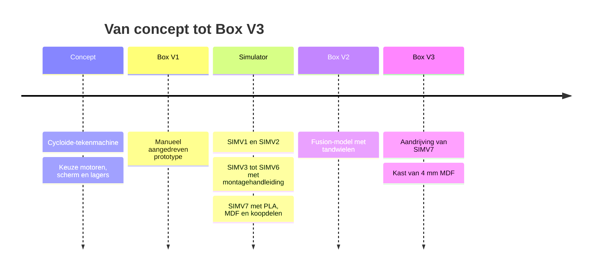

## Technologie

### Hardware

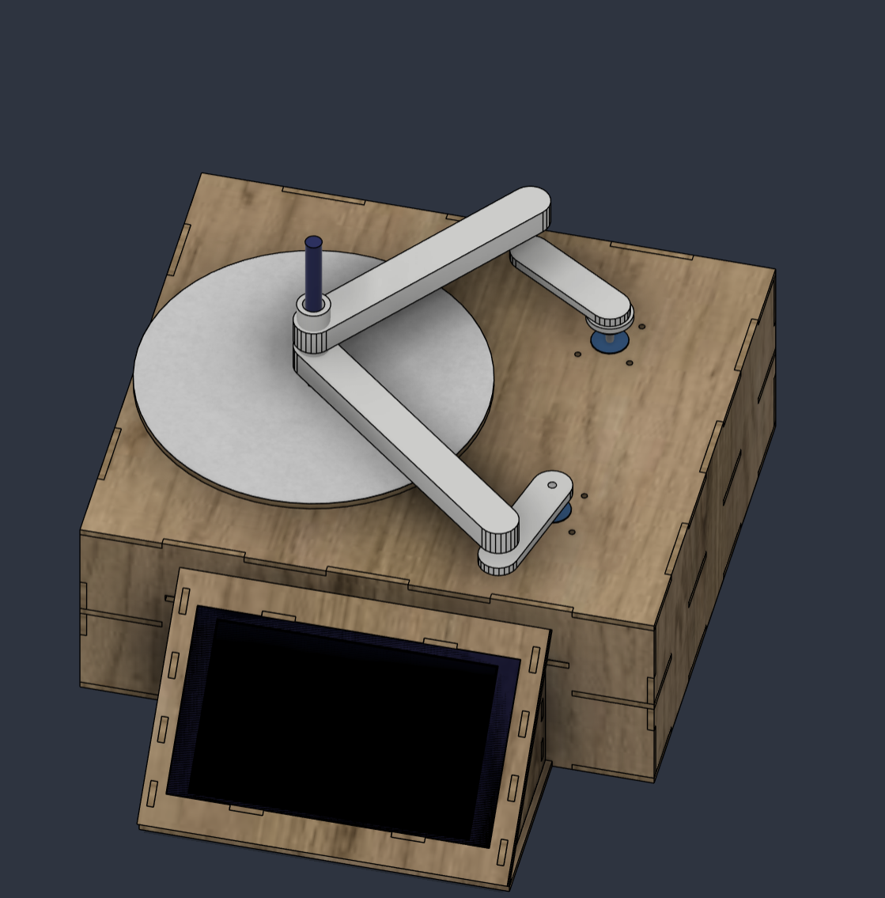

*Box V3: kast van 4 mm MDF met de twee armen, het plateau met papier en het schuine bedieningspaneel met scherm.*

- Stappenmotoren met dedicated drivers voor precisie-aansturing.
- Tekeninstrument als uitvoer naar papier.
- Bedieningspaneel met schuin scherm: zie [Bedieningspaneel](Hardware/Bedieningspaneel/README.md). Elektronicaschema's staan in [Schemas](Schemas).
- Raspberry Pi als besturingsplatform (zie [schermkeuzes](Research/Scherm/Scherm_gegevens.md) en [motor-aansturing](Research/Stappenmotoren/Stappenmotor_aansturing.md)).

### Software

- MOTIO SIMV7 als huidige simulator, met directe motoraandrijving en een geanimeerde montagehandleiding van 40 stappen. Eerdere versies staan op de [archiefbranch](https://github.com/vives-project-xp/Motio/tree/archive).
- Pi-interface ([motio.py](Software/Pi-Interface/motio.py)): de simulator berekent de motorstanden, de Raspberry Pi zet ze om in step-pulsen. Deze versie hoort nog bij SIMV5.
- Testcode voor [Raspberry Pi 5 en Arduino](Software/TestCode).
- Parameterbesturing voor snelheid, richting, fase en bewegingsverhouding.

## Onderdelenlijst (BOM)

De onderdelenlijst van Box V3: de aandrijving en de PLA-onderdelen van [SIMV7](Software/WARD-SIM/SIMV7/README.md) in een kast van **4 mm MDF** (343,4 × 304,3 × 128 mm, twee compartimenten, zie [Box V3](Research/concept/v3/README.md)). De MDF-onderdelen komen uit de [lasersnijgenerator](Research/concept/v3/lasersnij/generator/config.py). De rest komt uit de SIMV7-[BOM](Software/WARD-SIM/SIMV7/exports/MOTIO-V7-BOM.csv) (kooplinks in [SOURCING.md](Software/WARD-SIM/SIMV7/SOURCING.md)), met twee aanpassingen voor het dunnere hout: motorbouten en verzonken plateaubouten zijn M3×8 in plaats van M3×10. De ribben onder het deksel vervallen. De simulator zelf toont nog de SIMV7-lijst met 6 mm MDF.

Aantallen en maten zijn de ontwerpwaarden van Box V3, die in 4 mm MDF gebouwd is.

<details>
<summary><strong>Koopdelen</strong> · 20 regels, 70 stuks</summary>

| Aantal | Onderdeel | Afmetingen |
| ---: | --- | --- |
| 3 | SY42STH38-1684A-stappenmotor | 42,3 × 42,3 × 38; as Ø5 × 24 ±1 |
| 12 | Motorbout M3×8 | M3 × 8 · DIN 912 |
| 12 | Brede sluitring M3 | Ø9/3,2 × 0,8 · DIN 9021 |
| 3 | Metalen motornaaf Ø5 | Ø19 × 5; 4× M3 op steekcirkel Ø12,7 |
| 3 | Meegeleverde M3-naafstelschroef | M3 · inbus 1,5 mm |
| 4 | Krukbout A M3×10 | M3 × 10 · DIN 912 |
| 4 | Krukbout B M3×14 | M3 × 14 · DIN 912 |
| 8 | Kruksluitring M3 | Ø7/3,2 × 0,5 · DIN 125 |
| 1 | Scharnierbout A M8×50 | M8 × 50 · DIN 933 |
| 1 | Scharnierbout B M8×60 | M8 × 60 · DIN 933 |
| 4 | Sluitring M8 | Ø16/8,4 × 1,6 · DIN 125 |
| 2 | Borgmoer M8 | M8 · DIN 985 · hoogte 8 |
| 2 | Ellebooglager 608-2RS | 8 × 22 × 7 |
| 2 | Penlager 61804-2RS / 6804 | 20 × 32 × 7 |
| 1 | Klembout penhouder M3×20 | M3 × 20 · DIN 912 |
| 1 | Ingevangen moer M3 | M3 · DIN 934 · sleutel 5,5 |
| 1 | Ingevangen moer M4 | M4 · DIN 934 · sleutel 7 |
| 1 | Handklemschroef M4×25 | M4 × 25 · zeskantkop DIN 933 |
| 4 | Verzonken plateaubout M3×8 | M3 × 8, 90° |
| 1 | Tekenpen | Ø10 nominaal; circa 110 bruikbare lengte |

</details>

<details>
<summary><strong>Lasersnijden (4 mm MDF)</strong> · 6 regels, 8 stuks</summary>

| Aantal | Onderdeel | Afmetingen |
| ---: | --- | --- |
| 1 | Deksel (bovenplaat) | 343,4 × 304,3 × 4 mm |
| 1 | Tussenschot | 343,4 × 304,3 × 4 mm |
| 1 | Bodem | 343,4 × 304,3 × 4 mm |
| 2 | Voor- en achterwand | 343,4 × 128 × 4 mm |
| 2 | Zijwand | 304,3 × 128 × 4 mm |
| 1 | Draaiplateau | Ø210 × 4 mm |

</details>

<details>
<summary><strong>3D-printen (PLA)</strong> · 14 regels, 15 stuks</summary>

| Aantal | Onderdeel | Afmetingen |
| ---: | --- | --- |
| 1 | PLA-kruk A | 65 h.o.h.; 24 × 6; wortel Ø34; z=21 |
| 1 | PLA-kruk B | 65 h.o.h.; 24 × 6 + wortelboss Ø28×4; z=30 |
| 1 | PLA-scharnierafstandbus A | Ø14/8,4 × 16.5; laatste 2 mm Ø12 |
| 1 | PLA-penarm A | 180 h.o.h.; koker 24 × 16, wand 3 |
| 1 | PLA-scharnierafstandbus B | Ø14/8,4 × 28.5; laatste 2 mm Ø12 |
| 1 | PLA-penarm B | 160 h.o.h.; koker 24 × 16, wand 3 |
| 2 | PLA-bus boven ellebooglager | Ø12/8,4 × 4,5 |
| 1 | Holle PLA-penas met onderflens | Ø19,9/13 × 50; flens Ø24×5 |
| 1 | PLA-bus tussen penlagers | Ø24/20,2 × 14 |
| 1 | PLA-bus boven penlager | Ø24/20,2 × 9,5 |
| 1 | PLA-penhouder met klemoren | Ø28/13 × 22; onderboring Ø20,2 × 8 |
| 1 | PLA-penbus met bovenflens | Ø13/10,3 × 14; flens Ø16×1 |
| 1 | PLA-drukblok voor pen | 2 × 6 × 6 |
| 1 | PLA-handknop | 6 × 16 × 16; zeskantvak 7,2 |

</details>

<details>
<summary><strong>Papier</strong> · 1 regel, 1 stuk</summary>

| Aantal | Onderdeel | Afmetingen |
| ---: | --- | --- |
| 1 | Rond tekenpapier | Ø210; tekenzone Ø190 |

</details>

## Project Structuur

```bash
Motio/
├── documentation/    # Projectdocumentatie, afbeeldingen, architectuur en scrumverslagen
├── Hardware/         # Hardware: bedieningspaneel
├── Research/         # Onderzoek en keuzes (scherm, stappenmotor-aansturing, huidige Box V3)
├── Schemas/          # Elektronicaschema's (Raspberry Pi 5, gShield)
├── Software/         # Softwarecomponenten van het project
│   ├── Pi-Interface/ # Server die de simulator met de motoren verbindt
│   └── TestCode/     # Testcode Raspberry Pi 5 en Arduino
├── Software/WARD-SIM/ # Interactieve simulators
│   └── SIMV7/        # Laatste versie: PLA, MDF (ontwerp 6 mm, Box V3 bouwt 4 mm), koopdelen, 40 montagestappen
└── README.md         # Dit bestand
```

## Scrummeetings

De verslagen van onze scrummeetings staan in [documentation/Scrum](documentation/Scrum). Kopieer voor elke scrummeeting het [scrumtemplate](documentation/Scrum/template.md) en bewaar het ingevulde verslag in die map als `JJJJ-MM-DD-scrum.md`.

## Simulators

- [MOTIO SIMV7](Software/WARD-SIM/SIMV7/index.html): huidige en laatste versie, opvolger van SIMV6. PLA voor de maatdelen, lasergesneden MDF voor de kast (6 mm in het ontwerp, in Box V3 gebouwd in 4 mm), standaard koopdelen en een handleiding van 40 stappen met kooplinks. Het is een gecontroleerd ontwerp, nog geen fysiek beproefde machine. Zie [ontwerp en bediening](Software/WARD-SIM/SIMV7/README.md).

De eerdere simulatoren staan op de [archiefbranch](https://github.com/vives-project-xp/Motio/tree/archive/Software/WARD-SIM).

### Screenshots

Deze referentiebeelden komen uit [SIMV7](Software/WARD-SIM/SIMV7/index.html), de laatste versie van de simulator. De simulator toont de SIMV7-kast van 358 × 404 × 112 mm in 6 mm MDF; de gebouwde Box V3 is een kleinere kast van 4 mm MDF met dezelfde mechanica (zie hierboven).

**Simulator** – de bloem met vijf blaadjes, getekend op het ronde papier terwijl de machine in bovenaanzicht meebeweegt.

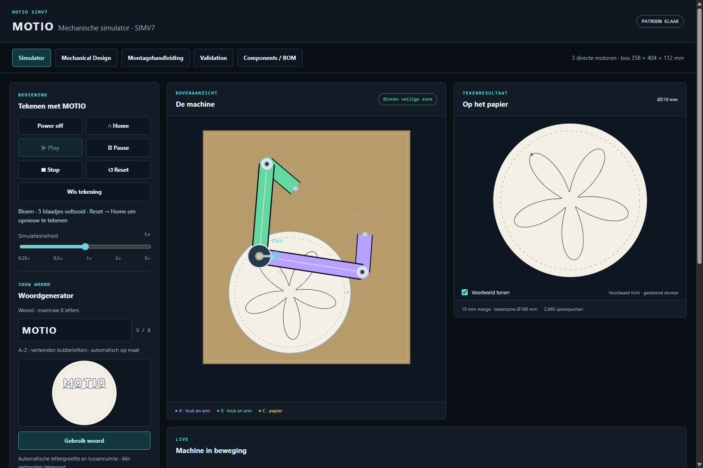

**Tekeningen** – het eindresultaat van de dertien ingebouwde patronen en een zelf getypt woord, zoals de simulator ze op het ronde papier tekent.

<table>
  <tr><td align="center">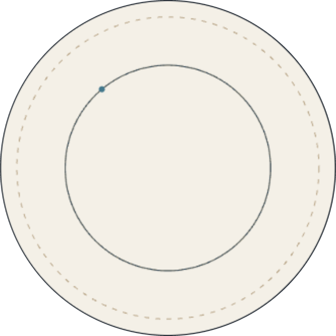<br><sub>Cirkel</sub></td><td align="center">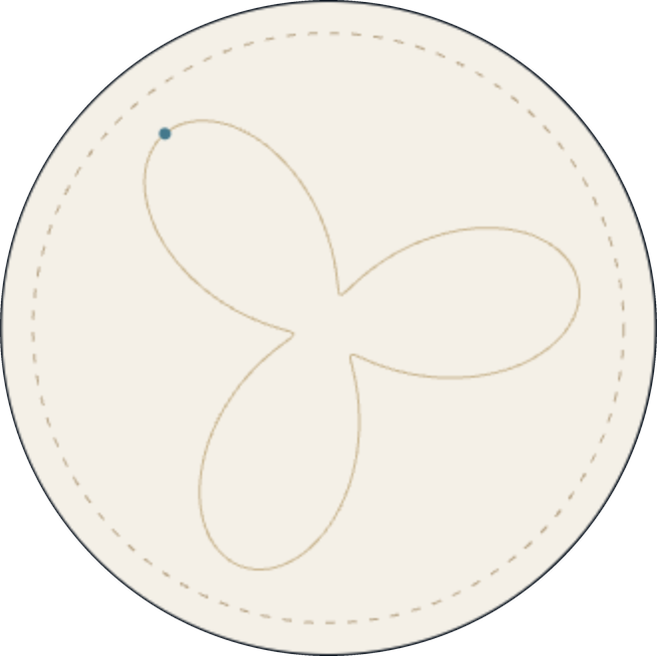<br><sub>Bloem · 3 blaadjes</sub></td><td align="center">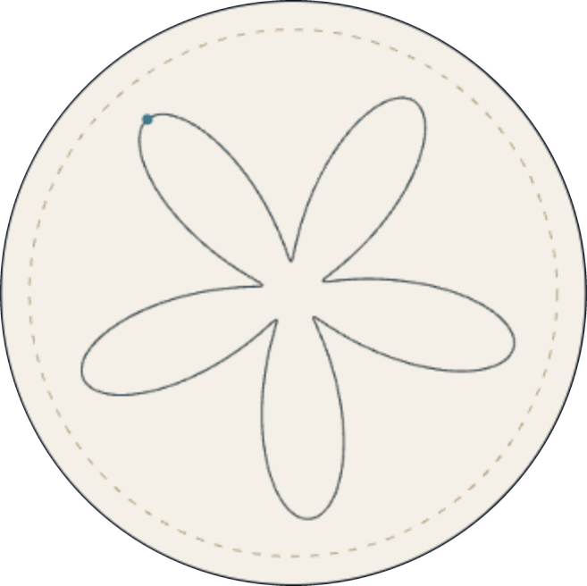<br><sub>Bloem · 5 blaadjes</sub></td><td align="center">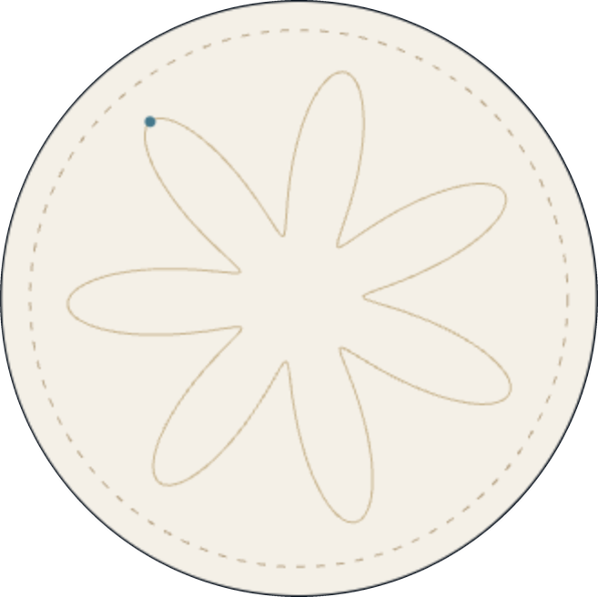<br><sub>Bloem · 7 blaadjes</sub></td></tr>
  <tr><td align="center">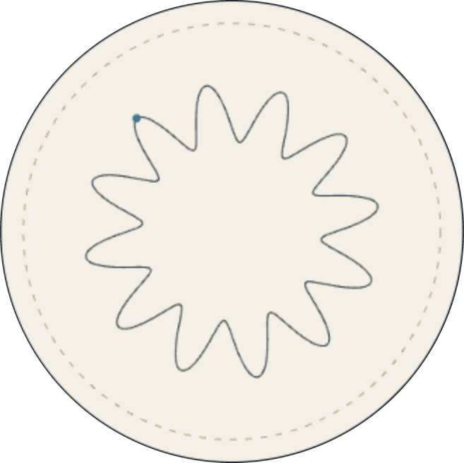<br><sub>Golfring</sub></td><td align="center">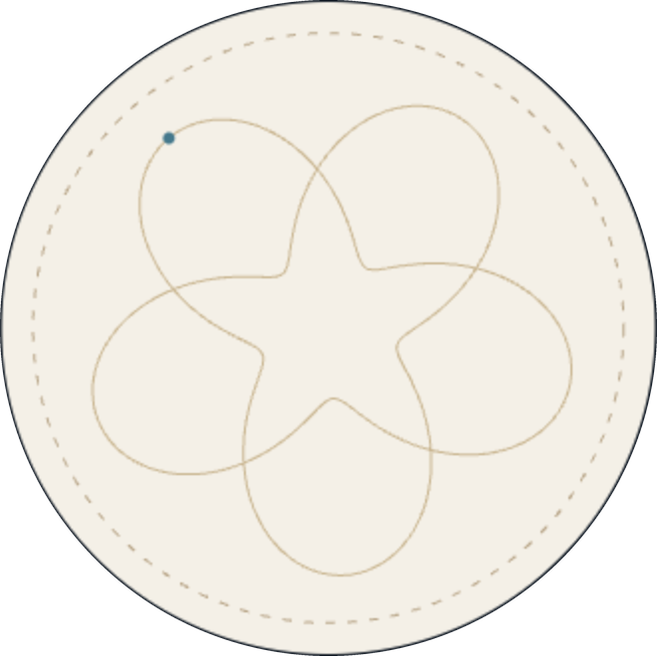<br><sub>Rozet · 2 rondes</sub></td><td align="center"><br><sub>Rozet · 3 rondes</sub></td><td align="center">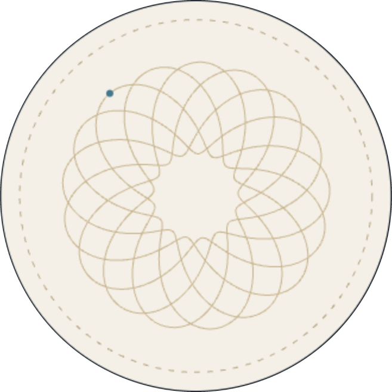<br><sub>Open rozet</sub></td></tr>
  <tr><td align="center"><br><sub>Verweven bloem</sub></td><td align="center">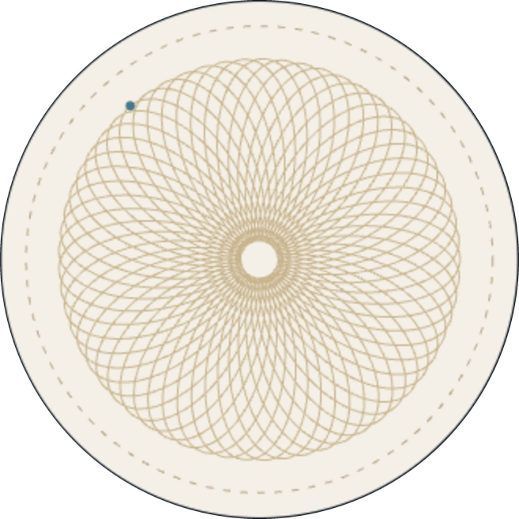<br><sub>Dichte rozet</sub></td><td align="center">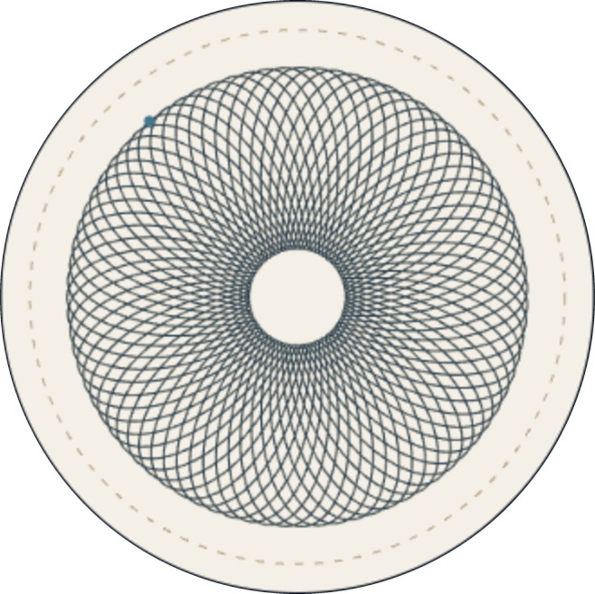<br><sub>Sterrozet</sub></td><td align="center">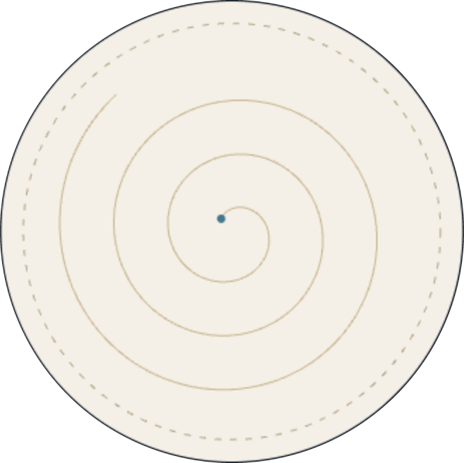<br><sub>Spiraal</sub></td></tr>
  <tr><td align="center">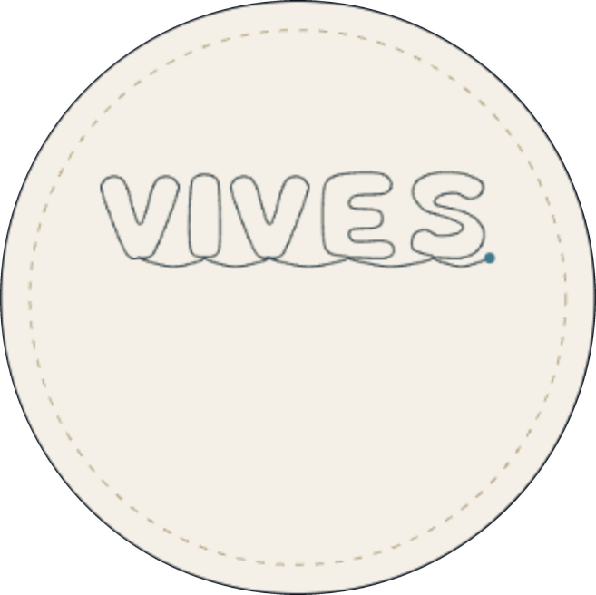<br><sub>VIVES</sub></td><td align="center"><br><sub>Eigen woord: MOTIO</sub></td></tr>
</table>

**Mechanical Design** – interactief 3D-model van de box en een technisch bovenaanzicht van de armen en het plateau.

|                       Interactief 3D-model                        |                      2D technische tekening                       |
| :---------------------------------------------------------------: | :---------------------------------------------------------------: |
| 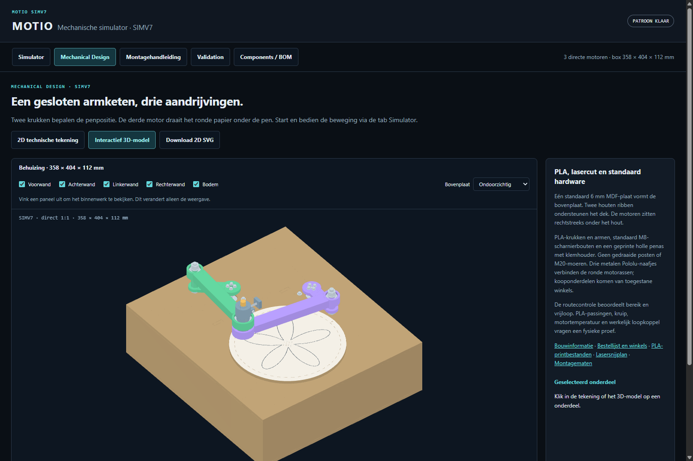 |  |

**Validation** – controles op bereik, botsingen, singulariteiten, motorcapaciteit, spelingen en constructiesterkte. Wat nog fysiek getest moet worden staat als *niet bewezen* aangeduid.

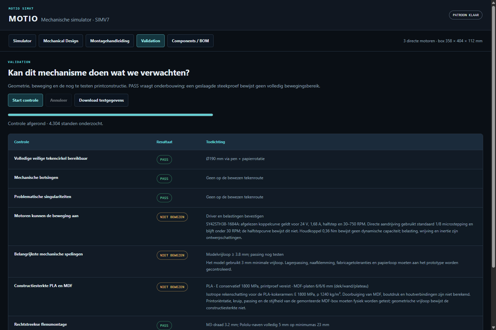

### Beginposter


## Team

|                                                                             |                |         |
| :-------------------------------------------------------------------------: | -------------- | ------- |
|  | Kyell De Windt | Teamlid |
|   | Jarno Bostyn   | Teamlid |
|  | Ward Dereeper  | Teamlid |
|    | Cobe Dudal     | Teamlid |
|      | Tibo Morgan    | Teamlid |

## Academische Context

|              |                          |
| ------------ | ------------------------ |
| Universiteit | VIVES Hogeschool         |
| Opleiding    | Bachelor Elektronica-ICT |
| Vak          | Project Experience       |
| Academiejaar | 2026-2027                |

Gemaakt door VIVES Bachelor Elektronica-ICT studenten.
