# Motio

*Makes motion visible.*

[](https://www.vives.be/nl/technology/elektronica-ict)
[](https://github.com/vives-project-xp)
[](https://github.com/vives-project-xp/Motio/tree/main)

> Een innovatief project voor het zichtbaar en tastbaar maken van beweging,
> door meerdere bewegende elementen om te zetten in fysieke tekeningen op papier.


## Inhoudsopgave

- [Motio](#motio)
  - [Inhoudsopgave](#inhoudsopgave)
  - [Projectoverzicht](#projectoverzicht)
  - [Projectstatus](#projectstatus)
  - [Functies](#functies)
  - [Hoe het werkt](#hoe-het-werkt)
  - [Technologie](#technologie)
    - [Hardware](#hardware)
    - [Software](#software)
  - [Project Structuur](#project-structuur)
  - [Simulators](#simulators)
    - [Screenshots](#screenshots)
    - [Beginposter](#beginposter)
  - [Team](#team)
  - [Academische Context](#academische-context)

## Projectoverzicht

Het Motio project is een initiatief ontwikkeld door 2de- en 3dejaars bachelorstudenten Elektronica-ICT van VIVES voor het vak Project Experience. Ons doel is het creëren van een systeem dat bewegingen tastbaar en zichtbaar maakt door ze om te zetten in fysieke tekeningen.

Het systeem combineert de beweging van meerdere elementen om complexe patronen te genereren. Een tekeninstrument vertaalt deze gecombineerde beweging naar lijnen op papier. Door parameters zoals snelheid, richting, fase en bewegingsverhouding te variëren, ontstaan telkens andere visuele patronen. Op die manier wordt de onderliggende beweging niet alleen geregistreerd, maar ook fysiek vastgelegd.

## Projectstatus

*Stand in oktober 2026.*

| Onderdeel | Status | Toelichting |
| --------- | ------ | ----------- |
| Concept & onderzoek | Afgerond | Cycloïde-tekenmachine, keuze motoren (SY42STH38-1684A), scherm en lagers. Zie [Research](Research/README.md). |
| Box V1 | Afgerond | Manueel aangedreven prototype dat één patroon tekent. Zie [UitlegBoxV1](Research/concept/UitlegBoxV1.md). |
| Box V2 | Afgerond (ontwerp) | Parametrisch Fusion-model (CycloidDrawerV2) en lasersnijbestanden met tandwielaandrijving. Vervangen door V3. |
| Box V3 | In uitwerking | Kast van 4 mm MDF met de motoraandrijving van SIMV7. Generator voor lasersnijbestanden en Fusion-script. Zie [Box V3](Research/concept/v3/README.md). |
| Simulator | Afgewerkt | SIMV1 t.e.m. SIMV7 met 13 patronen, woordgenerator, veiligheidscontroles en montagehandleiding. SIMV7 is de laatste versie. |
| Bedieningspaneel | In uitwerking | Wig van 4 mm MDF met 7" Raspberry Pi-scherm; maten en snijbestanden worden gegenereerd. Zie [Bedieningspaneel](Hardware/Bedieningspaneel/README.md). |
| Elektronica | Gestart | Schema's voor Raspberry Pi 5 en gShield, testcode voor motoraansturing (PWM). |
| Pi-interface | Eerste versie | `Software/Pi-Interface/motio.py` laat de simulator de echte motoren aansturen. Gebaseerd op SIMV5, dus nog geen SIMV7-driver, en nog niet getest op de volledige machine. |
| Volledige machine | Nog niet gebouwd | Mechanica en elektronica zijn nog niet samen werkend gemonteerd. |

### Volgende stappen

1. **Elektronica koppelen aan de mechanica:** de drie motoren werkend op de box, eerst met testcode, daarna via de Pi-interface.
2. **Materialen bestellen** zodat de machine gebouwd kan worden.
3. **Box V3 (SIMV7-ontwerp) bouwen** en de eerste echte tekening maken.
4. **Pi-interface bijwerken** naar SIMV7 (1/8 microstepping, juiste Home-referentie).

```mermaid
flowchart LR
    A[Concept en onderzoek] --> B[Simulator SIMV1 - SIMV7]
    B --> C[Box V1 - V3]
    C --> D[Elektronica koppelen]
    D --> E[Materialen bestellen]
    E --> F[Machine bouwen]
    F --> G[Eerste echte tekening]

    classDef klaar fill:#d4edda,stroke:#2e7d32,color:#111
    classDef bezig fill:#fff3cd,stroke:#b08900,color:#111
    classDef open fill:#f0f0f0,stroke:#888,color:#111
    class A,B klaar
    class C,D bezig
    class E,F,G open
```

## Functies

- **Instelbare parameters:** snelheden, richtingen en fase zijn makkelijk regelbaar.
- **Visualisatie:** de beweging wordt gevisualiseerd door een tekeninstrument dat lijnen op papier maakt.
- **Preview:** de simulator toont het verwachte resultaat licht op het papier, de echte tekenlijn verschijnt donker.
- **Patronen en woorden:** dertien kant-en-klare patronen en een woordgenerator (tot 8 letters) voor verbonden bubbelletters.
- **Veiligheidscontroles:** de simulator blokkeert singulariteiten, botsingen en posities buiten de veilige tekenzone.
- **Modulaire opbouw:** gescheiden hardware- en softwarecomponenten voor eenvoudige uitbreiding.

## Hoe het werkt

De simulator in de browser berekent de motorstanden en bewaakt de veiligheid. De Raspberry Pi 5 ontvangt die standen en zet ze om in step-pulsen voor de drie drivers op de gShield. Motor A en B bewegen de twee armen, motor C draait het plateau met het papier. De pen blijft op de samengestelde beweging van de armen en het plateau.

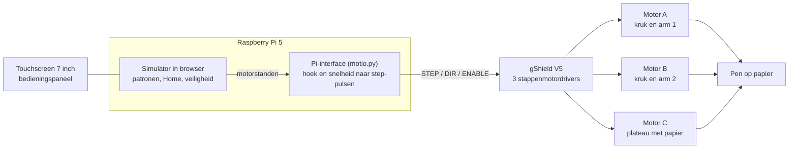

De pinindeling staat in het [hardwareschema](Schemas/Hardware%20schema.md) en in de [architectuurtekening](doc/Architectuur/ArchitectuurFoto.png).

### Evolutie van het ontwerp

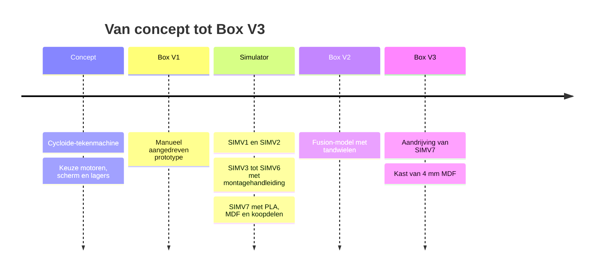

## Technologie

### Hardware

- Stappenmotoren met dedicated drivers voor precisie-aansturing.
- Tekeninstrument als uitvoer naar papier.
- Bedieningspaneel met schuin scherm: zie [Bedieningspaneel](Hardware/Bedieningspaneel/README.md). Elektronicaschema's staan in [Schemas](Schemas).
- Raspberry Pi als besturingsplatform (zie [schermkeuzes](Research/Scherm/Scherm_gegevens.md) en [motor-aansturing](Research/Stappenmotoren/Stappenmotor_aansturing.md)).

### Software

- MOTIO SIMV7 als huidige simulator, met directe motoraandrijving en een geanimeerde montagehandleiding van 40 stappen. Eerdere versies blijven beschikbaar.
- Pi-interface ([motio.py](Software/Pi-Interface/motio.py)): de simulator berekent de motorstanden, de Raspberry Pi zet ze om in step-pulsen. Deze versie hoort nog bij SIMV5.
- Testcode voor [Raspberry Pi 5 en Arduino](Software/TestCode).
- Parameterbesturing voor snelheid, richting, fase en bewegingsverhouding.

## Project Structuur

```bash
Motio/
├── doc/              # Projectdocumentatie, projectcanvas en architectuurschema
├── Hardware/         # Hardware: bedieningspaneel en snijbestanden box V1
├── Research/         # Onderzoek en keuzes (scherm, stappenmotor-aansturing, concepten v1/v2/v3)
├── Schemas/          # Elektronicaschema's (Raspberry Pi 5, gShield)
├── Software/         # Softwarecomponenten van het project
│   ├── Pi-Interface/ # Server die de simulator met de motoren verbindt
│   └── TestCode/     # Testcode Raspberry Pi 5 en Arduino
├── Software/WARD-SIM/ # Interactieve simulators
│   ├── SIMV1/        # Oorspronkelijke live simulator
│   ├── SIMV2/        # Virtueel prototype met machinebediening
│   ├── SIMV3/        # Behouden werkende basis met drie motoren, 2D/3D en BOM
│   ├── SIMV4/        # Compacte box 358 × 404 × 108 mm en instelbare zichtbaarheid
│   ├── SIMV4-5/      # Drie directe motoraandrijvingen
│   ├── SIMV5/        # Montagehandleiding met zes geanimeerde stappen
│   ├── SIMV6/        # Motoren tegen de bovenplaat, PETG-krukken, 38 montagestappen
│   └── SIMV7/        # Laatste versie: PLA, 6 mm MDF, koopdelen, 40 montagestappen
└── README.md         # Dit bestand
```

## Simulators

- [SIMV1](Software/WARD-SIM/SIMV1/index.html): oorspronkelijke live simulator.
- [SIMV2](Software/WARD-SIM/SIMV2/index.html): virtueel prototype met machinebediening, mechanische transmissies en engineeringweergave. Zie de [SIMV2-handleiding](Software/WARD-SIM/SIMV2/README.md).
- [MOTIO SIMV3](Software/WARD-SIM/SIMV3/index.html): behouden werkende basis met rond papier Ø210 mm, veilige tekenzone Ø190 mm, drie SY42STH38-1684A-motoren en 2D/3D-interface. Zie [ontwerp en controles](Software/WARD-SIM/SIMV3/README.md).
- [MOTIO SIMV4](Software/WARD-SIM/SIMV4/index.html): simulator met compacte opstelling, box 358 × 404 × 108 mm en afzonderlijke zichtbaarheid van wanden, bodem en bovenplaat. De drie motoren en bestaande bediening blijven behouden. Zie [starten en controles](Software/WARD-SIM/SIMV4/README.md).
- [MOTIO SIMV4-5](Software/WARD-SIM/SIMV4-5/index.html): behouden versie met drie directe motoraandrijvingen.
- [MOTIO SIMV5](Software/WARD-SIM/SIMV5/index.html): gebaseerd op SIMV4-5, met een tab **Montagehandleiding**: zes stappen, automatische opbouwanimaties, voortgang en herhalen. Zie [starten en bediening](Software/WARD-SIM/SIMV5/README.md).
- [MOTIO SIMV6](Software/WARD-SIM/SIMV6/index.html): gebaseerd op SIMV5. De motorflenzen zitten rechtstreeks tegen de MDF-bovenplaat, de krukken zijn PETG, en de handleiding telt 38 stappen met onderdelenlijst. De laatste wijziging (PETG-krukken) is nog niet getest. Zie [ontwerp en bediening](Software/WARD-SIM/SIMV6/README.md).
- [MOTIO SIMV7](Software/WARD-SIM/SIMV7/index.html): huidige en laatste versie, opvolger van SIMV6. PLA voor de maatdelen, 6 mm lasergesneden MDF voor de kast, standaard koopdelen en een handleiding van 40 stappen met kooplinks. Het is een gecontroleerd ontwerp, nog geen fysiek beproefde machine. Zie [ontwerp en bediening](Software/WARD-SIM/SIMV7/README.md).

### Screenshots

Deze referentiebeelden komen uit [SIMV4](Software/WARD-SIM/SIMV4/index.html).

**Simulator** – de bloem met vijf blaadjes, getekend op het ronde papier terwijl de machine in bovenaanzicht meebeweegt.

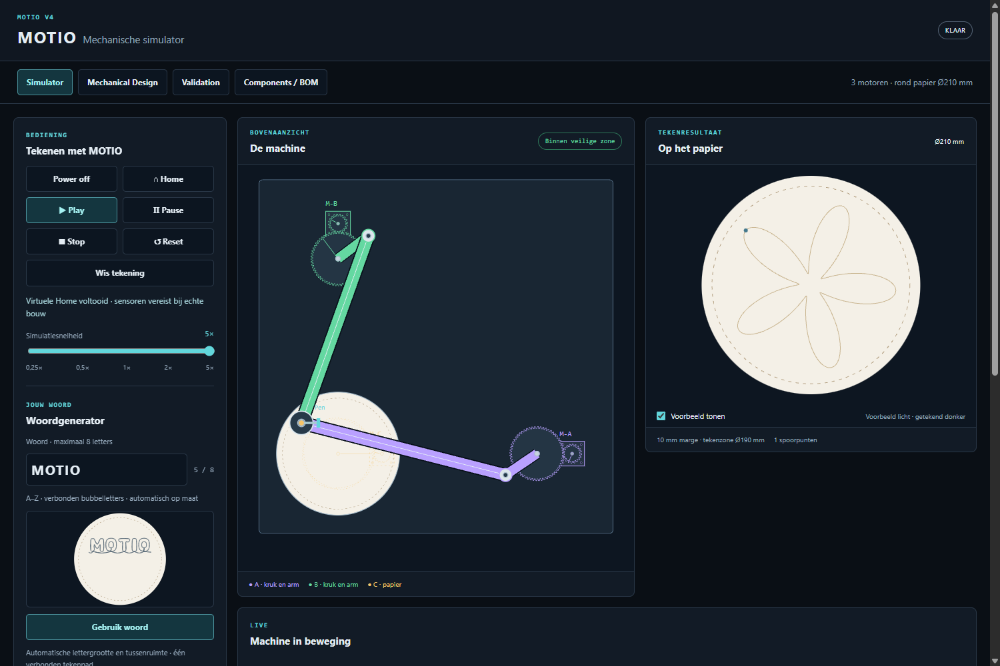 

**Tekeningen** – het eindresultaat van de dertien ingebouwde patronen en een zelf getypt woord, zoals de simulator ze op het ronde papier tekent.

<table>
  <tr><td align="center"><br><sub>Cirkel</sub></td><td align="center"><br><sub>Bloem · 3 blaadjes</sub></td><td align="center"><br><sub>Bloem · 5 blaadjes</sub></td><td align="center"><br><sub>Bloem · 7 blaadjes</sub></td></tr>
  <tr><td align="center">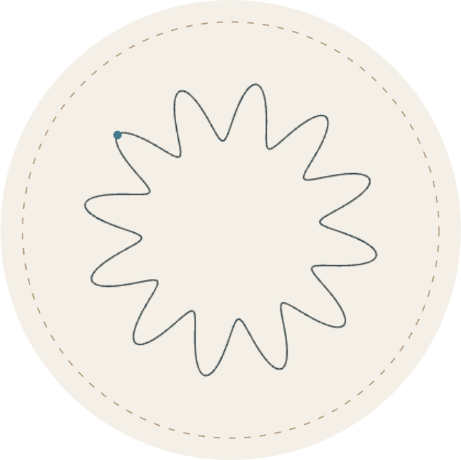<br><sub>Golfring</sub></td><td align="center">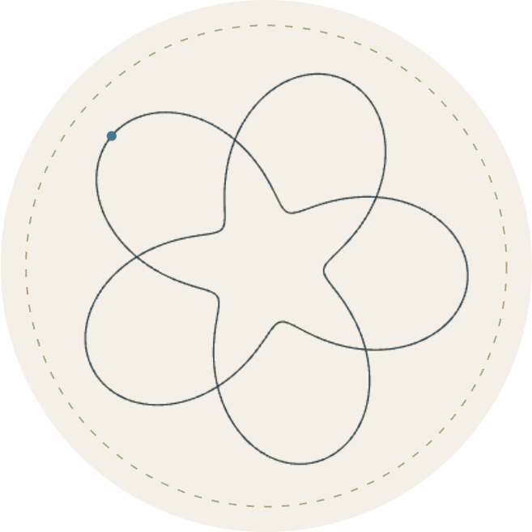<br><sub>Rozet · 2 rondes</sub></td><td align="center">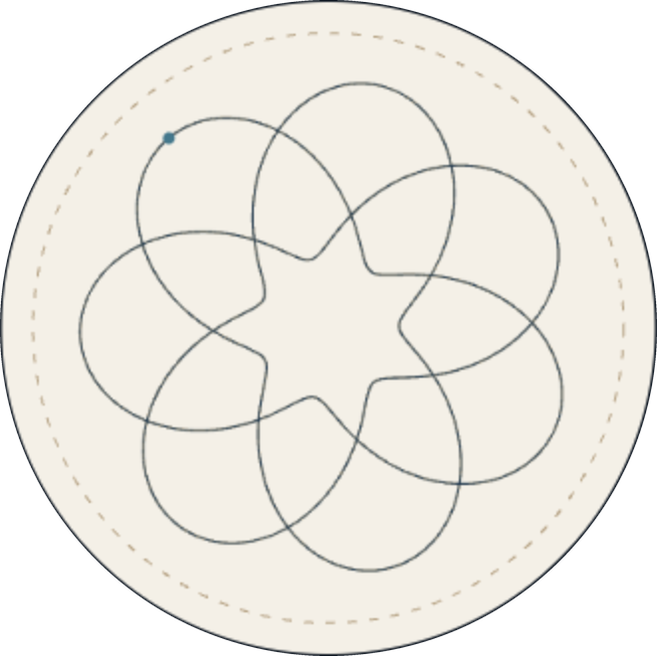<br><sub>Rozet · 3 rondes</sub></td><td align="center">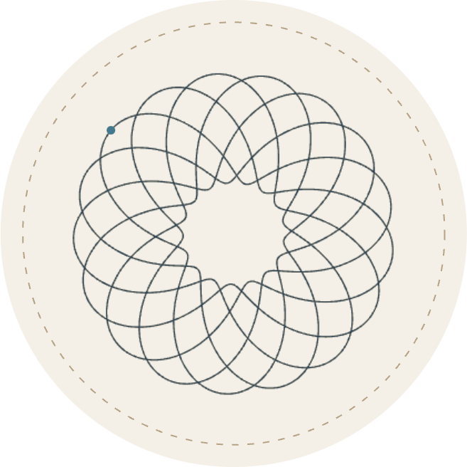<br><sub>Open rozet</sub></td></tr>
  <tr><td align="center">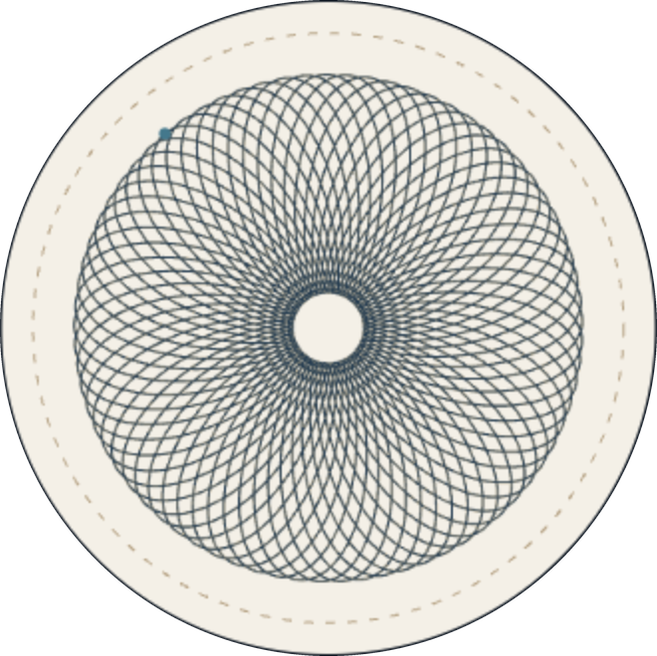<br><sub>Verweven bloem</sub></td><td align="center">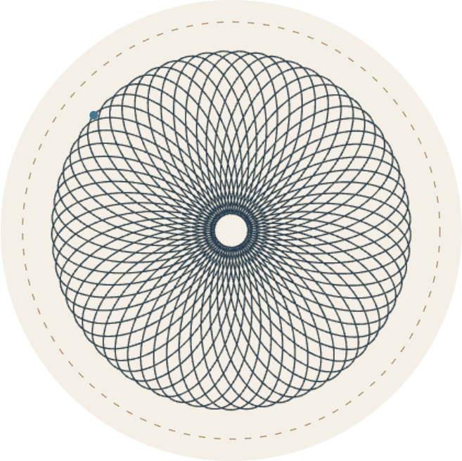<br><sub>Dichte rozet</sub></td><td align="center"><br><sub>Sterrozet</sub></td><td align="center">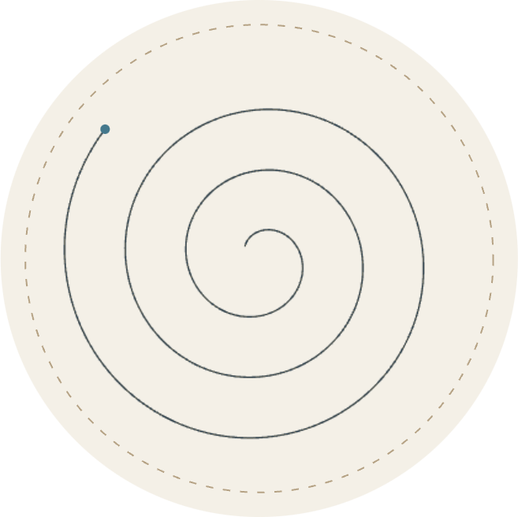<br><sub>Spiraal</sub></td></tr>
  <tr><td align="center">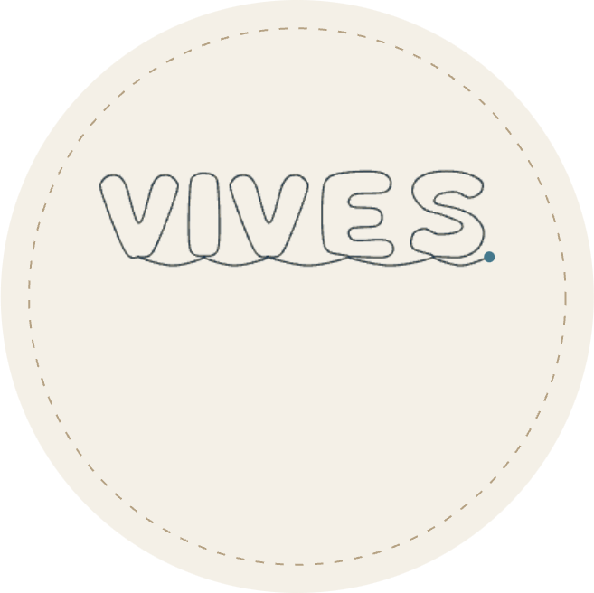<br><sub>VIVES</sub></td><td align="center">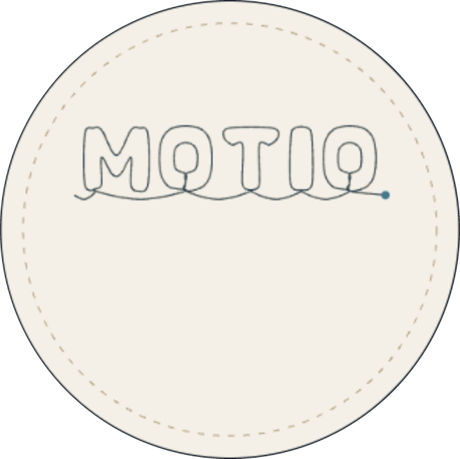<br><sub>Eigen woord: MOTIO</sub></td></tr>
</table>

**Mechanical Design** – interactief 3D-model van de box en een technisch bovenaanzicht met maten.

|                       Interactief 3D-model                        |                      2D technische tekening                       |
| :---------------------------------------------------------------: | :---------------------------------------------------------------: |
| 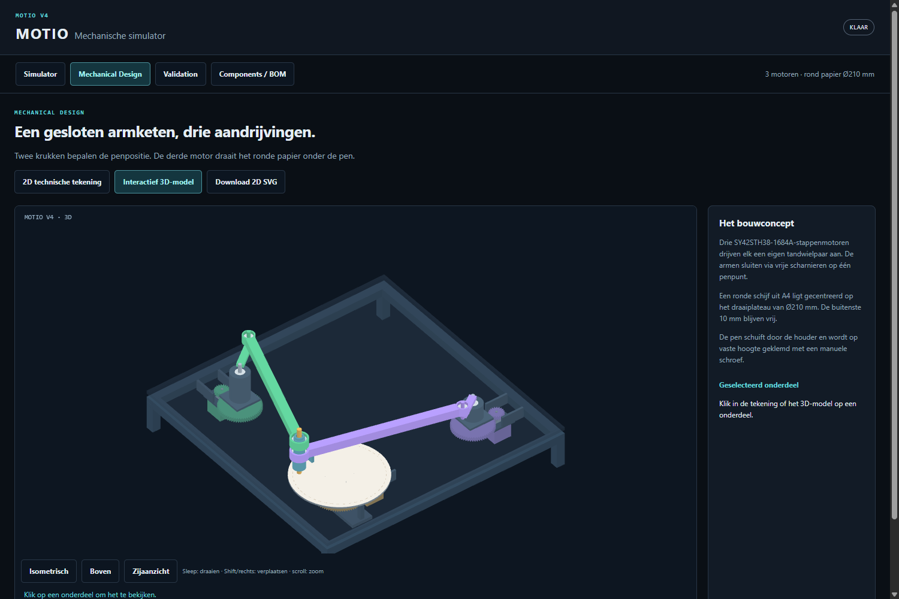 | 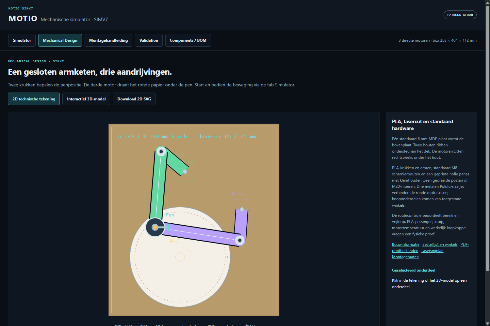 |

**Validation** – vijf controles op bereik, botsingen, singulariteiten, motorcapaciteit en spelingen.


### Beginposter

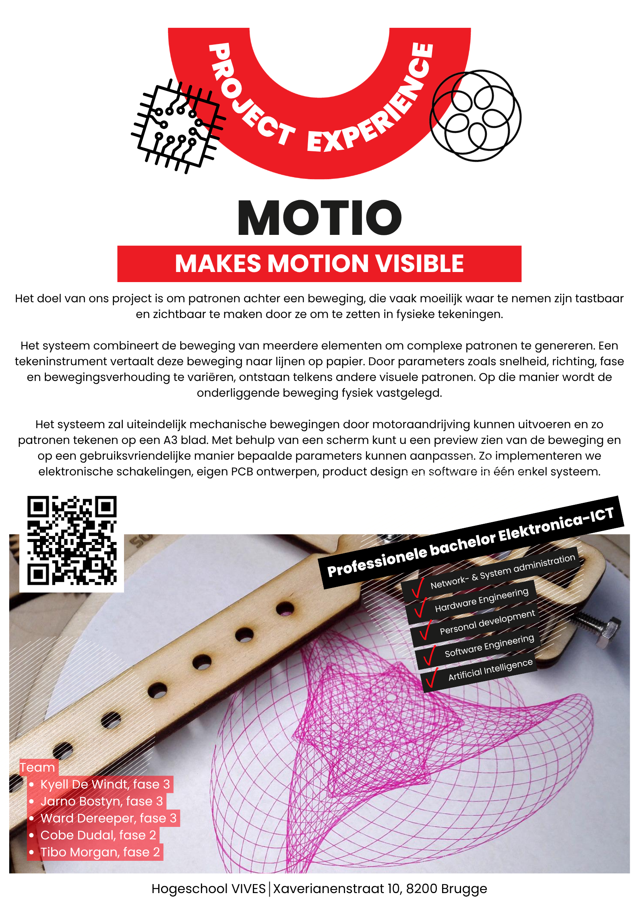

## Team

|                                                                             |                |         |
| :-------------------------------------------------------------------------: | -------------- | ------- |
|  | Kyell De Windt | Teamlid |
|   | Jarno Bostyn   | Teamlid |
|  | Ward Dereeper  | Teamlid |
|    | Cobe Dudal     | Teamlid |
|      | Tibo Morgan    | Teamlid |

## Academische Context

|              |                          |
| ------------ | ------------------------ |
| Universiteit | VIVES Hogeschool         |
| Opleiding    | Bachelor Elektronica-ICT |
| Vak          | Project Experience       |
| Academiejaar | 2026-2027                |

Gemaakt door VIVES Bachelor Elektronica-ICT studenten.
