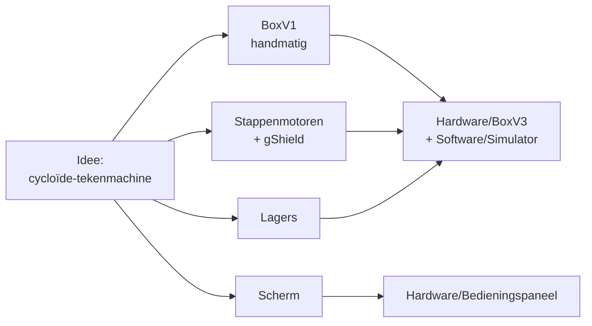

# Research

## Wat is dit?
Het onderzoek dat we deden **voor** we onderdelen kozen of bouwden: hoe werkt een stappenmotor, welke driver, welk scherm, welke lagers, en de eerste prototypes.

## Waarom staat het hier?
Dit is achtergrond, geen bouwinstructie. Je leest het om te begrijpen **waarom** we iets kozen. Wat je effectief bouwt staat in [Hardware](../Hardware/README.md) en [Software](../Software/README.md).

## Inhoud
| Map | Onderwerp | Lees dit als je wilt weten... |
|---|---|---|
| [Stappenmotoren](Stappenmotoren/README.md) | Werking, gegevens en aansturing van de motoren | waarom we de SY42STH38-1684A kozen |
| [gShield-v5b](gShield-v5b/README.md) | De driverkaart | hoe de driver werkt en wat hij kan |
| [Datasheets](Datasheets/README.md) | De originele PDF's | exacte technische waarden |
| [Onderdeelkeuzes](Onderdeelkeuzes.md) | Opties voor scherm en lagers (links) | welke schermen en lagers we overwogen en wat we kozen |
| [BoxV1](BoxV1/README.md) | Het eerste prototype | hoe het idee begon |
| [Fusion-tandwiel](Fusion-tandwiel/README.md) | Stappenplan voor tandwielen in Fusion 360 | hoe tandwielen getekend werden voor V1 en V2 |

## Hoe leidde het onderzoek tot het ontwerp?

