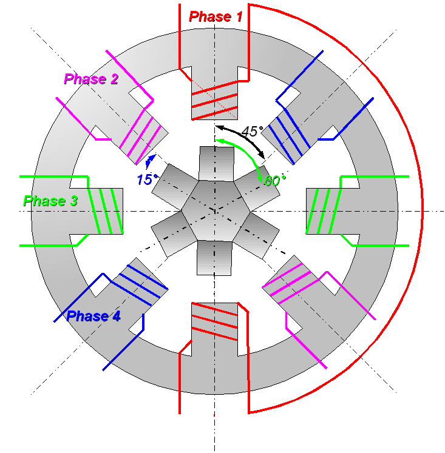
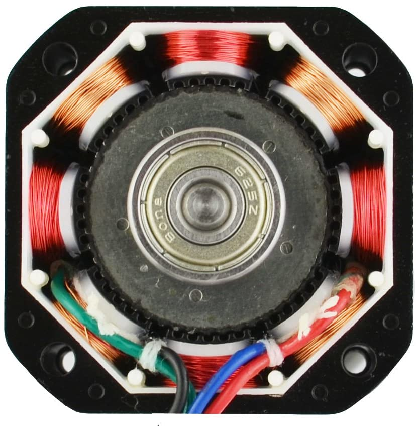
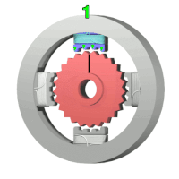
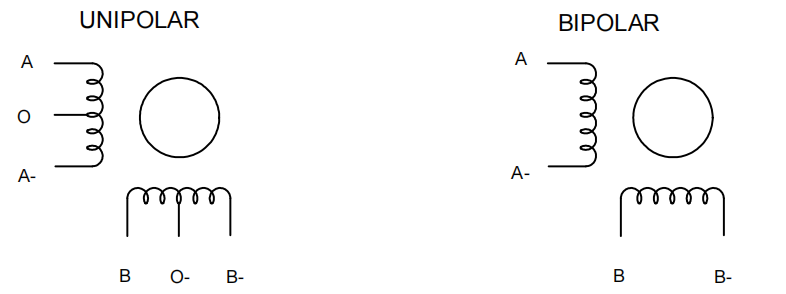

# Basis werking

## Wat is een stappenmotor
Een stappenmotor is een borstelloze synchrone gelijkstroommotor die digitale pulsen omzet in rotatie van een mechanische as.In tegenstelling tot veel andere standaardtypen motoren, draait een stappenmotor niet continu gedurende een bepaald aantal omwentelingen totdat de gelijkspanning die eraan wordt geleverd, wordt uitgeschakeld. Het heeft verschillende spoelen die in groepen zijn georganiseerd, de zogenaamde "fasen". Als elke fase beurtelings wordt ingeschakeld, draait de motor stap voor stap.

Stappenmotoren verdelen de gehele draaibeweging in meerdere gelijke stappen. Zolang de motor de juiste afmetingen heeft voor het koppel en de snelheid van de toepassing, kan de positie van de motor worden geregeld om in een van deze stappen te bewegen en daar te blijven zonder enige feedback van een positiesensor.

## Hoe werkt stappenmotor
Wanneer er stroom door de statorwikkeling vloeit, genereert de statorwikkeling een magnetisch vectorveld. Dit magnetische veld zal de rotor ertoe aanzetten om onder een bepaalde hoek te roteren, zodat de richting van het magnetische veld van de rotor consistent is met de richting van het magnetische veld van de stator. Wanneer het magnetische vectorveld van de stator over een hoek roteert. De rotor draait ook onder een hoek ten opzichte van dit magnetische veld. Elke keer dat er een elektrische puls wordt ingevoerd, draait de motor een hoek en gaat één stap vooruit. De uitgangshoekverplaatsing is evenredig met het aantal ingangspulsen, en de rotatiesnelheid is evenredig met de pulsfrequentie.

Verander de volgorde waarin de wikkelingen worden bekrachtigd en de motor zal van richting veranderen. Daarom kan de rotatie van de stappenmotor worden geregeld door het pulsnummer, de frequentie en de bekrachtigingsvolgorde van elke fasewikkeling van de motor te regelen.

De motor zet elektrische energie om in mechanische energie, en de stappenmotor is een regelelement met open lus dat elektrische pulssignalen omzet in hoekverplaatsing of lineaire verplaatsing. Onder omstandigheden zonder overbelasting zijn het toerental en de stoppositie van de motor alleen afhankelijk van de frequentie en het aantal pulsen van het pulssignaal en worden ze niet beïnvloed door veranderingen in de belasting. Met andere woorden: als een pulssignaal aan de motor wordt toegevoegd, zal de motor een staphoek draaien. Het bestaan ​​van deze lineaire relatie, gekoppeld aan de kenmerken van de stappenmotor die alleen periodieke fouten vertoont en geen geaccumuleerde fouten. Het maakt het heel eenvoudig om stappenmotoren te gebruiken om de snelheid, positie en andere controlegebieden te regelen.

## Unipolair en bipolair

Een stappenmotor is een motor die de rotatiehoek regelt door middel van elektrische pulsen. Bipolaire stappenmotoren en unipolaire stappenmotoren zijn twee veel voorkomende typen stappenmotoren. Het belangrijkste verschil tussen beide is de controlemethode. Een bipolaire stappenmotor moet de stroom omkeren om de richting van de rotor te veranderen, dus er zijn 4 elektroden nodig om de richting te regelen, elke elektrode heeft twee toestanden (AAN/UIT).

Een unipolaire stappenmotor heeft slechts twee elektroden nodig om de rotatie van de rotor te regelen, en de motor draait door de richting van de stroom te veranderen. Daarom hebben unipolaire stappenmotoren, vergeleken met bipolaire stappenmotoren, slechts 2 elektroden nodig om dezelfde bewegingscontrole te bereiken. Omdat unipolaire stappenmotoren echter de toevoeging van een unipolaire driver in het stuurcircuit vereisen, is de complexiteit van het circuit iets hoger.

Bipolaire stappenmotoren en unipolaire stappenmotoren hebben elk hun eigen voor- en nadelen, en de juiste motor kan worden geselecteerd op basis van het specifieke toepassingsscenario.

De voordelen van bipolaire stappenmotoren zijn een groot koppel, hoge snelheid, hoge precisie en eenvoudige bediening. Daarom worden ze vaak gebruikt in situaties waar snelle en uiterst nauwkeurige bediening vereist is. Het koppel en de precisie van unipolaire stappenmotoren worden vergeleken met die van bipolaire stappenmotoren. De motor is slechter en langzamer. Bovendien zijn de drivers die in unipolaire stappenmotoren worden gebruikt kostbaar en hebben ze minder opties.

## Voor- en nadelen van stappenmotoren
### Voordelen van stappenmotoren

Vanwege hun interne structuur hebben stappenmotoren geen sensoren nodig om de motorpositie te detecteren. Omdat de motor in "stappen" beweegt, kan door het simpelweg tellen van deze stappen de motorpositie op een bepaald moment worden bepaald.
Stappenmotoren zijn bovendien zeer eenvoudig te besturen. Hoewel de motor een driver nodig heeft, zijn er geen complexe berekeningen of instellingen nodig om goed te kunnen functioneren. Over het algemeen is de hoeveelheid werk die nodig is voor de besturing lager in vergelijking met andere motoren. Met de microstepping-methode kun je een hoge positioneringsnauwkeurigheid bereiken van maximaal ongeveer 0,007°.
Stappenmotoren bieden een groot koppel bij lagere snelheid, zijn uitstekend geschikt voor het vasthouden van positie en hebben een lange levensduur.

### Nadelen van stappenmotoren
De rotor van de stappenmotor heeft een grote massa en een hoge traagheid. Het is gevoelig voor trillingen en geluid tijdens gebruik op hoge snelheid, wat de stabiliteit en nauwkeurigheid van de beweging beïnvloedt. Dit is een groot nadeel van stappenmotoren en er moeten maatregelen worden genomen om dit effect te verzachten of te elimineren.
Het werkingsprincipe van de stappenmotor is het regelen van de positie en snelheid door middel van onmiddellijke pulscontrole op korte termijn. Bij langdurig gebruik kan de motor gemakkelijk oververhit raken of zelfs doorbranden. Voor toepassingen die langdurig continu gebruik vereisen, zijn stappenmotoren mogelijk niet de beste keuze.

Bronnen:
(https://www.stepperonline.nl/stappenmotoren)
https://nl.wikipedia.org/wiki/Stappenmotor