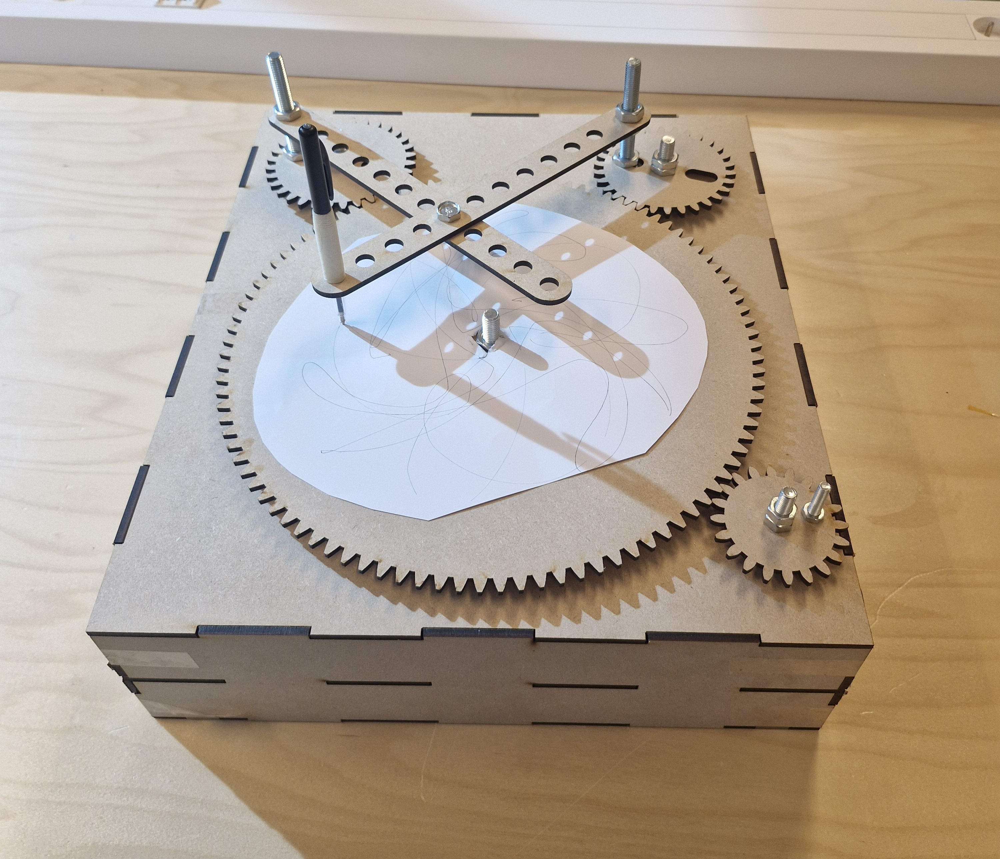
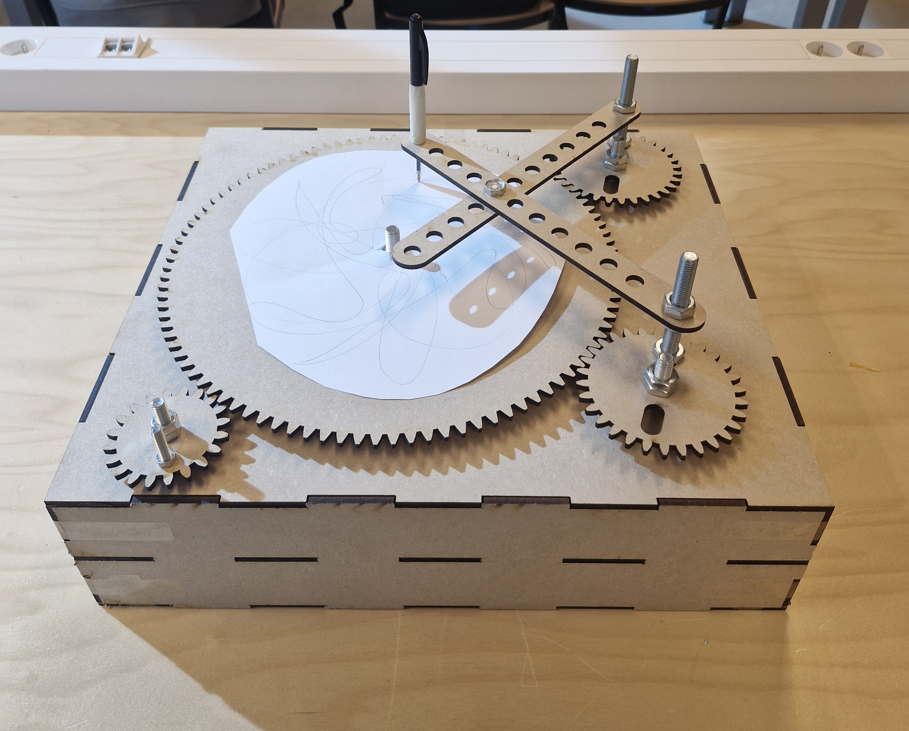

# Box vesrie 1
In deze map zal het gemaakte onderzoek in verband met dit project terug te vinden zijn.

## Functionaliteit
De functionaliteit van de eerst versie bestaat enkel uit manuele aandrijving. Deze versie bevat nog geen integratie van elektronische componenten en is enkel in staat om 1 patroon te tekenen.

## Aandrijving
De aandrijving van V1 gebeurt manueel door een persoon die draait aan een stang. Door het draaien roteert een tandwiel, vervolgens worden ook andere tandwielen verder aangedreven. Alle tandwielen draaien gelijktijdig met als resultaat dat het blad roteert en de armen een bepaalde beweging uitvoeren.

Aan een arm is een balpen bevestigd die tekent op het blad.

## Bevindingen
We hebben van deze eerste versie veel bijgeleerd.
-	We merkten dat bouten te lang waren
-	We merkten hoe we de stabiliteit konden verbeteren
-	We zagen dat er een stevige manier nodig was om het blad op zijn plaats te houden
Deze zaken nemen we zeker mee naar de volgende versies.
