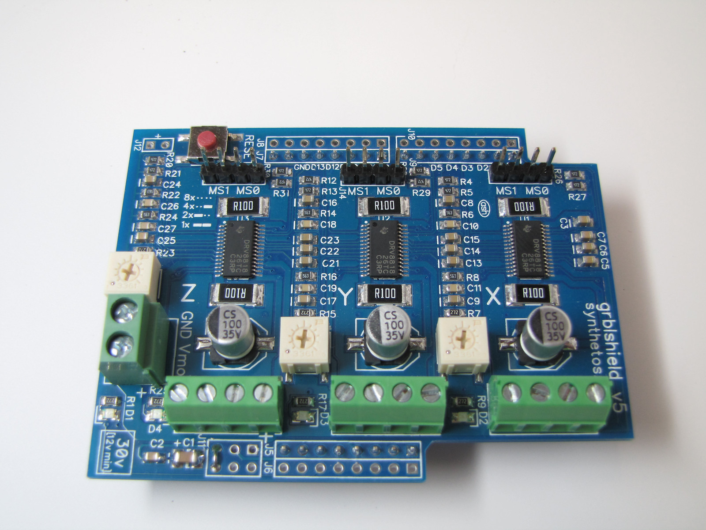

# Basis werking

## Wat is gShield v5b driver
De gShield v5b (grblShield v5) is een stappenmotordriver-shield voor Arduino. Het wordt gebruikt om een Arduino om te vormen tot een CNC-controller die drie stappenmotoren (X-, Y- en Z-as) kan aansturen. Het shield werkt samen met de populaire GRBL-firmware.

De gShield kan ook gebruikt worden om TinyG2 te runnen op the Arduino Due. Dit kan omdat TinyG2 een ARM port van de TinyG motion control system is.

## Wat doet de gShield v5b?
- Stuurt tot 3 stappenmotoren aan (X, Y, Z).

- Zet stappen- en richtingssignalen van een Arduino om naar de vermogenssignalen die een stappenmotor nodig heeft.

- Werkt met een voedingsspanning van 12 V tot 30 V voor de motoren.

- Kan tot 2,5 A per winding leveren.

- Ondersteunt 8× microstepping, waardoor motoren vloeiender bewegen.

- Gebruikt drie Texas Instruments DRV8818 stappenmotordrivers.

## Wat bevat het bord
**3× DRV8818 stappenmotor-driver IC's (meer hier later over)** 
Zijn de drivers van de motoren zelf. 

**Vermogensweerstanden** 
Controleerd de ontwikkeling van warmte. 

**Lage weerstand.** 
Worden gebruikt door de DRV8818 om de motorstroom te meten en te regelen. 

**Instelpotentiometers (trimpots)** 
Voor het instellen van de maximale motorstroom per as. 

**Microstep-jumpers** 
Headerpinnen waarmee je full-step, half-step, quarter-step of 1/8-step kunt selecteren. 

**Schottky- en beveiligingscomponenten** 
Voor bescherming tegen spanningspieken en foutieve aansluitingen. 

**Ontkoppelcondensatoren** 
Keramische condensatoren dicht bij de DRV8818-chips.
Elektrolytische voedingscondensatoren voor de motorvoeding. 

**Weerstanden** 
Pull-up- en pull-downweerstanden voor de besturingssignalen. 

**LED-indicatoren** 
Voedings-LED en soms status-LED's. 

**Schroefklemmen** 
Motoruitgangen (A+, A−, B+, B−).
Voedingsingang (12 tot 30 V). 

**Arduino Shield-connectors**
Stackable headers die rechtstreeks op een Arduino Uno passen.
Wij gebruiken kabels om verbindingen te leggen. 

**Eindschakelaar- en hulpaansluitingen**
Voor limit switches, reset, spindle-enable en andere GRBL-functies. 

## Wat is de DRV8818 IC
Het is de stappenmotor-driver IC die de signalen van de Arduino omzet in de hoge stromen die nodig zijn om een stappenmotor aan te sturen.
De volledige werking van de IC is terug te vinden in de documentatie van Texas Instruments.

Het bevat twee H-brug-drivers en logica voor microstappen om een stappenmotor te besturen. Hierdoor kan de motor in twee richtingen draaien.

Het regelt ook de motorstroom (stroomregeling met PWM), zodat de motor niet te veel stroom trekt.

### Belangrijkste gegevens

35 V en 2,5 A met stroomregeling en 1/8 microstappen.

28 pinnen (9,70 × 4,40 mm).

Onderspanningsbeveiliging, overstroombeveiliging en thermische uitschakeling. 

Er is een uitgang HOMEn die aangeeft dat de indexer op de beginpositie staat.
Texas Instruments noemt hem een driver voor printers, scanners en andere geautomatiseerde apparaten.

## Wat is onze toepassing voor de gShield v5b driver
Wij gebruiken de gShield v5b driver als driver voor drie motoren te sturen met een Raspberry PI 5. We hebben vergeleken met de pinnen die gebruikt werden bij de Arduino en zo enkel de noodzakelijke pinnen voor de Raspberry PI 5 overgehouden. We hebben Python gebruikt inplaats van Arduino om de motoren aan te sturen.

Bronnen:
  https://github.com/synthetos/grblShield
  https://www.ti.com/product/DRV8818