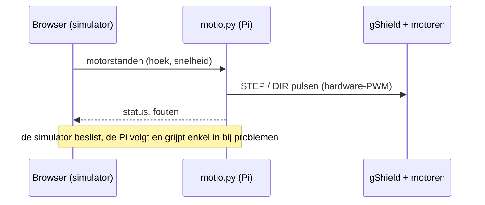

# Pi-Interface

## Wat is dit?
Eén Python-bestand, [motio.py](motio.py), dat op de Raspberry Pi 5 draait en twee dingen doet:

1. Het toont de bedieningspagina met de simulator in de browser (webserver, standaard poort 8080).
2. Het ontvangt van die pagina de motorstanden (hoek en snelheid van A, B en C) en zet ze om in STEP-pulsen voor de drivers.

## Waarom een apart bestand?
Alles zit in één bestand, zodat je op de Pi maar **één bestand** moet kopiëren. De bedieningspagina zit erin verpakt. Dat is geen goede structuur voor onderhoud, maar het is wel de eenvoudigste uitrol.

## Hoe werkt het?

## Gebruik
Zie de [opstartgids](../../Documentation/Pi-opstarten.md): installeren, bedrading, hardware-PWM, opstarten en problemen oplossen.

## Let op
- **Hoort bij SIMV5**, niet bij de huidige [SIMV7](../Simulator/README.md). SIMV7 gebruikt 1/8 microstepping (1600 pulsen/omwenteling), deze code nog 1/16. Dat moet bij de hardware-integratie op elkaar afgestemd worden.
- Deze code is nog niet getest op de volledige machine.
- Afsluiten kan met de EXIT-knop rechtsboven en code 1234.
