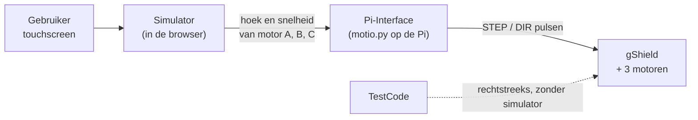

# Software

## Wat is dit?
Alles wat **draait**: de simulator in de browser en de code op de Raspberry Pi die de echte motoren aanstuurt.

## Waarom staat het hier?
Software en hardware hebben een andere levenscyclus. Je bouwt de kast één keer, de code verander je regelmatig. De fysieke onderdelen staan in [Hardware](../Hardware/README.md).

## Inhoud
| Map | Wat zit erin? | Wanneer open je dit? |
|---|---|---|
| [Simulator](Simulator/README.md) | Webapp (SIMV7): berekent de beweging, toont patronen, bevat ook het ontwerp, de onderdelenlijst en de montagehandleiding | Je wilt een patroon bekijken of het ontwerp begrijpen |
| [Pi-Interface](Pi-Interface/README.md) | Python-server op de Pi: zet de motorstanden van de simulator om in pulsen | Je wilt de echte motoren laten draaien |
| [TestCode](TestCode/README.md) | Kleine testprogramma's voor Raspberry Pi 5 en Arduino | Je wilt enkel testen of een motor of driver werkt |

## Hoe werkt het samen?

De simulator is **de baas**: patronen, Home en veiligheidscontroles zitten daarin. De Pi-Interface volgt alleen.

## Let op
- De Pi-Interface is gebaseerd op de oudere simulator **SIMV5**. De huidige simulator is SIMV7. De koppeling met SIMV7 is dus nog niet gemaakt (zie [Pi-Interface](Pi-Interface/README.md)).
- Oudere simulatorversies (SIMV1 t.e.m. SIMV6) staan op de [archiefbranch](https://github.com/vives-project-xp/Motio/tree/archive/Software/WARD-SIM).
