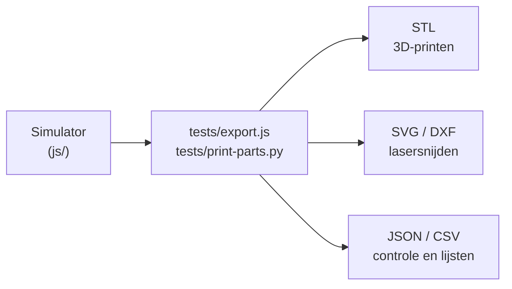

# exports

## Wat is dit?
Alles wat de simulator **uitvoert** voor de echte wereld: 3D-printbestanden, lasersnijbestanden, de onderdelenlijst, tekeningen en controlerapporten.

## Waarom staat het in git?
Zo kan iemand zonder Node.js of Python de onderdelen direct printen en snijden. Deze bestanden worden **gegenereerd**: pas ze niet met de hand aan, maar pas de simulator aan en genereer opnieuw (zie [tests](../tests/README.md)).

## Inhoud
| Soort | Bestanden | Gebruik |
|---|---|---|
| 3D-printen | `*.stl` (14 onderdelen + 2 passingproeven) | Printen in PLA. Aantallen en instellingen: [PRINTING.md](PRINTING.md) |
| Lasersnijden | `*-bottom`, `-front-back`, `-platter`, `-rib`, `-side`, `-top-plate` als `.svg` en `.dxf` | Snijden in MDF. `MOTIO-V7-laser-layout.svg` is het snijplan op een plaat |
| Tekeningen | `*-mechanical`, `-mounting`, `-section`, `-pen-detail` (`.svg`) | Uitleg bij montage |
| Onderdelenlijst | `MOTIO-V7-BOM.csv` | Wat je moet kopen of maken |
| Controlerapporten | `design-validation.json`, `pattern-validation.json`, `print-validation.json` | Bewijs dat het ontwerp klopt |
| Manifests | `laser-manifest.json`, `print-manifest.json` | Machineleesbare lijst van de onderdelen |
| Voorbeeldbeelden | `*-preview.png` | Snel bekijken zonder bestanden te openen |

## Hoe ontstaan ze?

## Let op
De kast van [BoxV3](../../../Hardware/BoxV3/README.md) is 4 mm MDF en gebruikt **niet** de MDF-bestanden hier (die zijn voor 6 mm). Van deze map gebruikt Box V3 enkel de **STL-bestanden** (de PLA-onderdelen).
