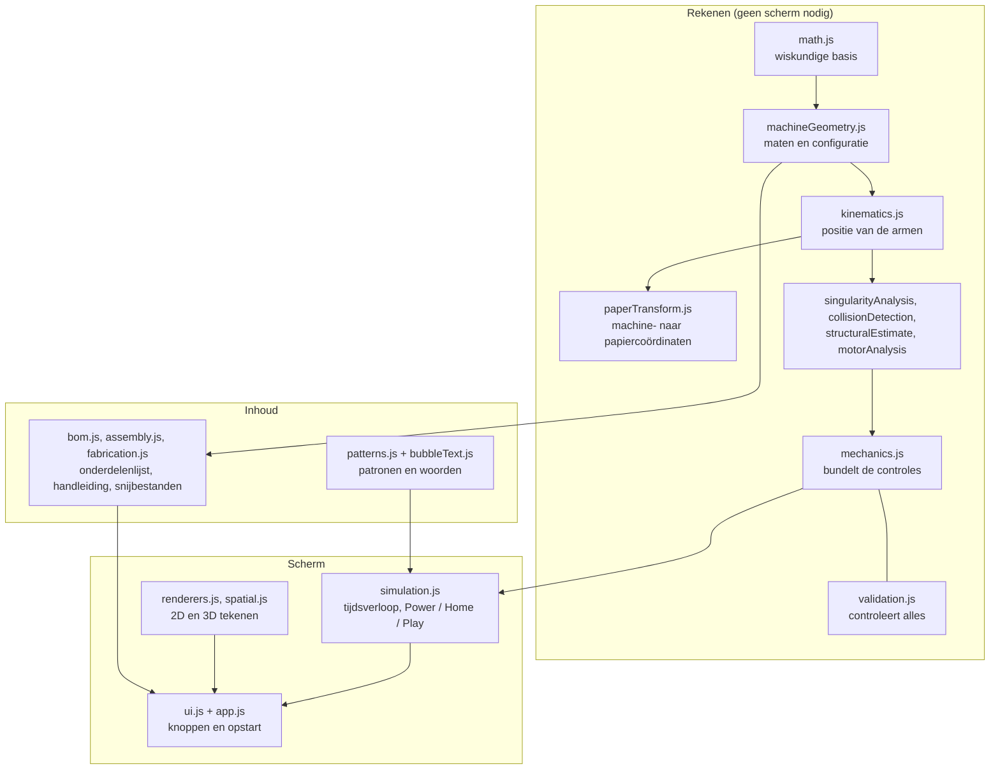

# js: de code van de simulator

## Wat is dit?
De volledige logica van de simulator in gewoon JavaScript, zonder framework of installatie. [index.html](../index.html) laadt de bestanden in volgorde; elk bestand hangt aan `window` (bv. `MotioMath`) zodat de volgende het kan gebruiken.

## Waarom zo opgesplitst?
Elk bestand doet één ding. De berekeningen (links) hebben geen scherm nodig en worden daardoor met Node getest zonder browser (zie [tests](../tests/README.md)).

## Lagen

## Bestanden
| Bestand | Verantwoordelijkheid |
|---|---|
| `math.js` | Afstand, kruisproduct, snijden van lijnstukken |
| `machineGeometry.js` | Standaardconfiguratie en alle maten van de machine |
| `kinematics.js` | Waar staan de armen en de pen bij gegeven motorhoeken (en omgekeerd) |
| `paperTransform.js` | Zet punten van de machine om naar het draaiende papier |
| `singularityAnalysis.js` | Waarschuwt als de armen bijna gestrekt of samengevouwen staan |
| `collisionDetection.js` | Controleert dat onderdelen elkaar niet raken |
| `structuralEstimate.js` | Schat de belasting op de armen |
| `motorAnalysis.js` | Schat of de motoren genoeg koppel hebben (uit de datasheet, niet gemeten) |
| `mechanics.js` | Voert bovenstaande controles samen uit |
| `validation.js` | Controleert het ontwerp als geheel |
| `patterns.js`, `bubbleText.js` | De 13 patronen en de woordgenerator |
| `simulation.js` | De tijdlus: motorsnelheden, Power, Home, Play, pauzeren |
| `bom.js` | Onderdelenlijst met kooplinks |
| `assembly.js` | De 40 stappen van de montagehandleiding |
| `fabrication.js` | Maakt de maten voor het snijden en 3D-printen |
| `renderers.js`, `spatial.js` | Tekent het papier (2D) en de machine (3D) |
| `ui.js`, `app.js` | Koppelt alles aan de knoppen en start de app |

## Een patroon of onderdeel toevoegen
- Nieuw patroon: `patterns.js` (en eventueel een knop in `ui.js`). Voer daarna `node tests/patterns.test.js` uit.
- Andere maat: `machineGeometry.js`. Voer daarna alle tests uit, zie [tests](../tests/README.md).
