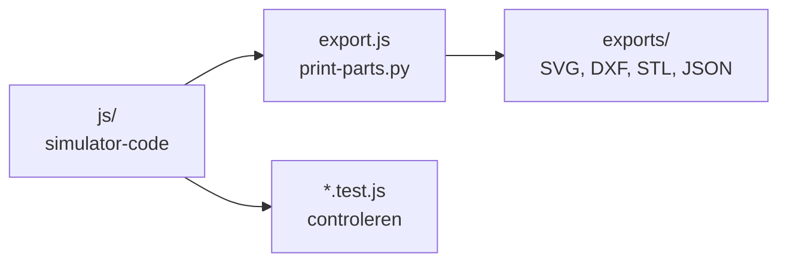

# tests

## Wat is dit?
Automatische controles voor de simulator en hulpscripts om de exportbestanden opnieuw te maken.

## Waarom?
De simulator beweert dat het ontwerp veilig is (vrijloop, bereik, singulariteiten). Deze tests bewijzen dat na elke wijziging opnieuw. Draai ze dus altijd na een aanpassing in [js](../js/README.md).

## Controles (Node.js)
Vanuit de map `Software/Simulator`:

```powershell
node tests/logic.test.js
node tests/construction.test.js
node tests/assembly-connections.test.js
node tests/integration.test.js
node tests/patterns.test.js
```

| Test | Wat controleert het? |
|---|---|
| `logic.test.js` | Rekenlogica van de modules: kinematica, controles, patronen, simulatie |
| `construction.test.js` | Onderdelen en boorgaten uit de onderdelenlijst en de fabricage |
| `assembly-connections.test.js` | Dat de montagestappen en de verbindingen tussen onderdelen kloppen |
| `integration.test.js` | De pagina `index.html` met alle scripts samen, in een nagebootste browser |
| `patterns.test.js` | De patronen en hun verloop in de simulatie |
| `browser.test.js` | Optioneel: een echte browser-test (Playwright, eerst `serve.js` starten) |

## Exportbestanden opnieuw maken
| Script | Wat maakt het? |
|---|---|
| `export.js` | Schrijft de SVG-, DXF-, JSON- en manifestbestanden naar [exports](../exports/README.md) |
| `render-preview.js` | Maakt de voorbeeldafbeeldingen (PNG) in exports |
| `print-parts.py` | Maakt de STL-bestanden voor 3D-printen. Vereist Python en `requirements-print.txt` |
| `serve.js` | Kleine lokale webserver om de simulator te bekijken |



## Let op
`print-parts.py` zoekt zijn Python-pakketten (numpy, trimesh) in `tmp/simv7-tools` in de hoofdmap, of in de map uit de omgevingsvariabele `MOTIO_PYTHON_MODULES`. Die `tmp/`-map staat niet in git. Gebruik anders een virtuele omgeving, zie de [simulator-README](../README.md#controles-opnieuw-uitvoeren).
