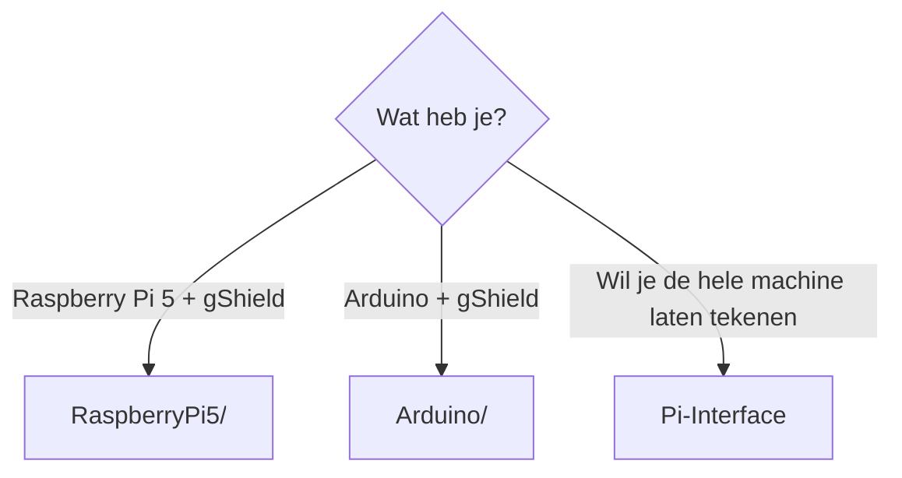

# TestCode

## Wat is dit?
Kleine programma's om **de hardware te testen**, los van de simulator. Handig om te zien of een motor, driver of pin werkt voor je de volledige software gebruikt.

## Waarom staat het hier?
Het zijn tijdelijke hulpmiddelen, geen onderdeel van de eigenlijke applicatie. Daarom staan ze apart van [Simulator](../Simulator/README.md) en [Pi-Interface](../Pi-Interface/README.md).

## Inhoud
| Map | Voor welk bord? | Wat doet het? |
|---|---|---|
| [RaspberryPi5/](RaspberryPi5/README.md) | Raspberry Pi 5 | Venster met knoppen om de drie motoren te laten draaien, met hardware-PWM |
| [Arduino/](Arduino/README.md) | Arduino + gShield | Stuurt de drie motoren aan via UART-commando's |

## Welke gebruik ik?

